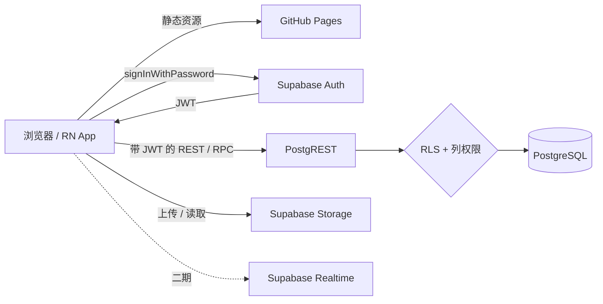
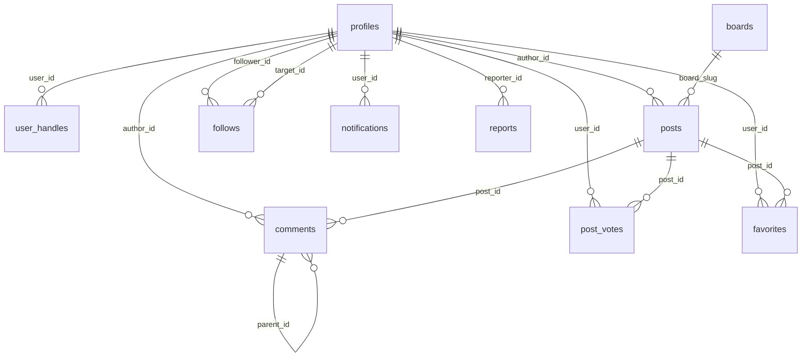

# 校园论坛设计方案 v2.5

> 版本：v2.5（全面重写，取代 v1.0；v2.5 **取消匿名**，保留关注）
> 日期：2026-11-01
> 状态：待评审，**未开始编码**
> 目标：前端（React）静态部署在 GitHub Pages，数据存在 Supabase，**不维护任何自建服务器**；用户名登录用 1 个 Edge Function（serverless）。数据库与前端代码全部重写，不复用旧项目任何代码。

---

## 0. 版本说明与变更摘要

### 0.1 这一版和 v1.0 的关系

v1.0 的设计方向（Supabase Auth + RLS + 真表）是对的，但有 6 处会导致**功能直接跑不起来**或**权限被绕过**的缺陷，并且前端方案（原生 HTML + ES Modules）已按新要求废弃。v2.0 不是打补丁，是重写：

| 维度 | v1.0 | v2.2 |
|---|---|---|
| 前端 | 原生 HTML + 内联 `onclick` + ES Modules | **React 19 + TypeScript + Vite + Tailwind** |
| 前端组织 | 单页 HTML 堆叠 `div` | **路由 + 组件 + 特性目录** |
| 状态管理 | 全局 `window.App` | **TanStack Query（服务端状态）+ Zustand（UI 状态）** |
| 数据库 | 9 张表，部分约束缺失 | **10 张核心表**（含 `user_handles`），约束齐全，全新 schema |
| 权限模型 | 只用 RLS（行级） | **RLS + 列级权限 + RPC 三层防线** |
| 计数保护 | 触发器拦 `auth.uid()` | **列级权限（触发器方案已被证明有 bug）** |
| 登录方式 | 合成邮箱（收不到信） | **邮箱 + 用户名 + 密码**（用户名登录走 Edge Function） |
| 用户名存储 | 混在 `profiles` 里 | **独立表 `user_handles`**（支持改名留痕、防抢注） |
| 匿名实现 | `author_id` 公开 + `profiles` 全员可读 | **v2.5 取消匿名**，公开显示 `display_name`，`user_handles` 仍不公开 |
| 好友系统 | 未提及 | **二期做**（第 7 节保留完整设计） |
| 部署 | 手动推 main | **GitHub Actions 构建后发布 Pages** |
| 移动端 | 未考虑 | **Monorepo 预留 `packages/core`，二期接 React Native** |

### 0.2 六个必须记住的教训（来自 v1.0 复盘）

这六条是 v2.x 的设计约束，写在最前面，后面所有设计都要能解释它们：

1. **`security definer` 只换执行身份，不换 JWT。** 函数里 `auth.uid()` 仍是调用者，所以用触发器「拦截非管理员改计数」会连带把点赞、评论一起打死。→ 计数保护改用**列级权限**。
2. **RLS 是行级，不是列级。** 用户能改自己那行，就能改 `role`。→ 必须叠加**列级 `GRANT`**。
3. **触发器 + 前端可直写的明细表 = 计数必然漂移。** → `post_votes` / `favorites` **禁止直写**，只走 RPC。
4. **策略里调用自定义函数时，函数必须先存在。** → SQL 执行顺序 **schema → functions → policies → seed**。
5. **登录名一旦能被公开读到，账号就容易被撞库。** → `user_handles` 不对公众开放，作者主页用 `profiles.id` 而非 username。
6. **前端可以绕过，数据库不能。** 所有校验（长度、格式、频率、封禁、锁帖）必须在数据库里再写一遍。

### 0.3 v2.5 变更（相对 v2.4）

| # | 变更 | 原因 |
|---|---|---|
| 1 | **取消匿名设计**，删除 `anonymous_name` 字段 | 用户要求 |
| 2 | 删除 4 处化名快照字段（`posts` / `comments` / `notifications`） | 不再需要 |
| 3 | `profiles` 改为**公开可读**（列级 GRANT 只放行公开列） | 显示作者昵称 |
| 4 | 作者主页路径从 `#/a/:anonymousName` 改为 **`#/u/:userId`** | 无化名可用；且不暴露 username |
| 5 | `toggle_follow` 参数从化名改为 **`p_target_id uuid`** | 直接可靠，无需唯一化名 |
| 6 | `posts_by_anonymous_name` → **`posts_by_author(p_user_id)`** | 同上 |
| 7 | 新增 `author_profile(p_user_id)` 返回作者公开资料 | 主页顶部展示 |
| 8 | 删除 `anonymous_name` 唯一索引与 uid 后缀生成逻辑 | 不再需要 |

### 0.4 历史变更

| 版本 | 关键变化 |
|---|---|
| v2.0 | 全面重写：React + TS + Vite；数据库全新 schema；RLS + 列权限 + RPC 三层权限；修复 v1.0 六处缺陷 |
| v2.1 | 认证改为邮箱 + 用户名 + 密码；新增第 7 节好友系统冲突分析；新增附录 B.2 局域网聊天系统复用分析 |
| v2.2 | 用户名独立建表 `user_handles`；好友系统确定推迟二期；补充防抢注与部分唯一索引设计 |
| v2.3 | 认证方案 A 定稿（Edge Function）；修复 join `auth.users` 的 bug；补充部署三坑与限流方案 |
| v2.4 | 新增关注功能与作者主页；`anonymous_name` 改唯一；新增 4 个 RPC 与关注通知触发器 |
| v2.5 | **取消匿名**；删除化名与快照体系；`profiles` 公开可读；关注改为按 user id |

---

## 1. 定位与范围

### 1.1 定位

面向本校同学的轻量校园论坛：

- 实名化发言：显示用户昵称，可点进主页查看其历史帖子；
- 板块化内容：闲聊、学习、表白、失物、交友；
- 图片、点赞/踩、评论、收藏、关注、举报、通知；
- 管理员：删帖、置顶、锁定、封禁、处理举报；
- 全部在免费额度内运行，自己维护；
- 架构上为二期移动端（React Native）留好复用层。

### 1.2 第一版（MVP）范围

| # | 功能 | 优先级 |
|---|---|---|
| 1 | 注册（邮箱 + 用户名 + 昵称 + 密码） | P0 |
| 2 | 登录（邮箱；用户名登录走 Edge Function） | P0 |
| 3 | 退出 / 会话保持 / 修改密码 / 找回密码 | P0 |
| 4 | 五个预置板块 | P0 |
| 5 | 帖子列表（分页、板块筛选、最新/最热） | P0 |
| 6 | 帖子详情 | P0 |
| 7 | 发帖（标题、正文、板块、图片） | P0 |
| 8 | 评论（一级，预留楼中楼字段） | P0 |
| 9 | 点赞 / 踩（RPC，防重复） | P0 |
| 10 | 收藏 | P1 |
| 11 | **关注 / 取关 + 作者主页** | **P1** |
| 12 | 个人中心（我的帖子 / 评论 / 收藏 / 关注 / 粉丝 / 资料） | P0 |
| 13 | 通知（评论通知、未读标记） | P1 |
| 14 | 举报（帖子 / 评论 / 用户） | P1 |
| 15 | 管理后台（删帖、置顶、锁帖、封禁、举报处理） | P1 |
| 16 | 搜索（标题 + 正文） | P1 |
| 17 | 社区规则页 | P0 |

**第一版明确不含好友 / 私信**，已定为二期（详见第 7 节）。

> **关注与好友的区别（别混淆）：** 关注是单向、公开、免同意的；好友是双向、需要申请-同意的。第一版只做关注。

### 1.3 第二版再做

- **好友与私信**（**二期已实现**：`#/friends` 好友页 + `#/messages` 私信页，见第 7 节）；
- Supabase Realtime 实时通知（**二期已实现**：通知 + 私信走 WebSocket，轮询降级为兜底）；
- 楼中楼评论；
- **移动端 App（React Native + Expo）**；
- 敏感词库与自动审核（**二期已实现**：`banned_words` 词库 + 触发器拦截发帖/评论/昵称/用户名，管理后台可增删）；
- 用户反馈与建议收集（**二期已实现**：`/#/feedback` 提交 + 「我的反馈」进度 + 管理后台「反馈」标签查看与标记处理）；
- 数据导出与备份脚本（**二期已实现**：`npm run db:export` 导出全表快照 + manifest 校验和，`--verify` 校验完整性）；
- 邀请码 / 学号验证（**二期决定不做**：校内熟人小圈子，暂不需要注册门槛）。

### 1.4 明确不做

- **自建后端服务器**（不维护任何常驻进程；但有 1 个 Edge Function 用于用户名登录，见 5.3.1 的准确表述）；
- 前端 localStorage 存业务数据；
- 代码里写死管理员账号密码；
- 前端存密码或密码哈希；
- 前端使用 `service_role` key（仅 Edge Function 服务端使用）；
- SSR / Next.js（静态托管用不上，反而增加部署复杂度）。

---

## 2. 技术选型

### 2.1 前端

| 层次 | 选型 | 版本 | 理由 |
|---|---|---|---|
| 框架 | **React** | 19.x | 生态最大；**二期移动端也用 React，可复用数据层与类型** |
| 语言 | **TypeScript** | 5.x | 数据库类型可由 Supabase 自动生成，接口改动能编译期发现 |
| 构建 | **Vite** | 7.x | 秒级启动，产物纯静态，适配 GitHub Pages |
| 样式 | **Tailwind CSS** | 4.x | 用 `@tailwindcss/vite` 插件，无需 `tailwind.config.js`，CSS 优先配置 |
| 组件 | **shadcn/ui**（Radix 底座） | 最新 | 源码复制进项目，不锁版本，可按需裁剪，无运行时依赖包袱 |
| 路由 | **React Router** | 7.x | `createHashRouter`，GitHub Pages 无需 404 回退 |
| 服务端状态 | **TanStack Query** | 5.x | 缓存、重试、无限滚动、**乐观更新**，正好覆盖点赞/收藏场景 |
| 客户端状态 | **Zustand** | 5.x | 只存主题、侧边栏这类 UI 状态，不存业务数据 |
| 表单 | **React Hook Form + Zod** | 最新 | 非受控表单性能好；Zod schema 与数据库 CHECK 一一对应 |
| 图标 | **lucide-react** | 最新 | 纯 SVG 组件，无 CDN 依赖 |
| 提示 | **sonner** | 最新 | 轻量 toast |
| 工具 | clsx + tailwind-merge | 最新 | 类名合并 |
| SDK | `@supabase/supabase-js` | 2.x | Auth / REST / Storage 一体 |
| 质量 | ESLint 9（flat config）+ Prettier + `tsc --noEmit` | | |
| 测试 | Vitest + Testing Library | | 第一版只覆盖纯函数与关键 hook |

### 2.2 后端 / 基础设施

| 层次 | 选型 | 说明 |
|---|---|---|
| 数据库 | Supabase Postgres | 免费额度够用 |
| 认证 | Supabase Auth | 密码哈希、JWT、会话托管 |
| 存储 | Supabase Storage | 替代 imgBB |
| 实时 | 第二版再接 | 第一版轮询 + 手动刷新 |
| 部署 | GitHub Pages + GitHub Actions | 构建后发布 `dist` |
| 版本管理 | Git + GitHub | SQL 迁移文件一并入库 |

### 2.3 为什么是 React，不是 Vue / Svelte

决定性理由不是生态，而是**你二期要做 React Native 移动端**。

Monorepo 里 `packages/core` 可以同时被 `apps/web`（React DOM）和 `apps/mobile`（React Native）导入：Supabase 客户端、Zod 校验、Query hooks、业务类型全部共享。Vue 做不到这一点（只能共享纯 TS，hooks 层要重写一遍）。Svelte 同理，且生态更薄。

### 2.4 为什么不用 Next.js

- 部署目标是 GitHub Pages 纯静态，Next 的 SSR / ISR / Route Handler 全部用不上；
- 论坛首屏不需要 SEO（内容在客户端登录后才完整）；
- Next 的构建产物与 base path 在 Pages 上更麻烦；
- 引入 App Router 等于多学一套心智模型，收益为零。

Vite + React Router 足够。

### 2.5 为什么 Tailwind 用 v4 而不是 CDN

v1.0 用 `cdn.tailwindcss.com` 是运行时 JIT，100KB+ 且国内访问不稳，还容易把 `<link>` 写错。v4 的 `@tailwindcss/vite` 在构建期生成，产物只有实际用到的类，**零 CDN 依赖**，国内直连快。

---

## 3. 仓库结构（Monorepo，为移动端预留）

```
campus-forum/
├─ pnpm-workspace.yaml
├─ package.json                    # 根脚本：dev / build / lint / typecheck
├─ tsconfig.base.json
├─ .nvmrc                          # Node 22
├─ .editorconfig
├─ .gitignore
├─ .env.example
├─ README.md
│
├─ apps/
│  └─ web/                         # 一期：React Web
│     ├─ index.html
│     ├─ vite.config.ts            # base: '/<repo>/'
│     ├─ tsconfig.json
│     └─ src/
│        ├─ main.tsx
│        ├─ App.tsx
│        ├─ router.tsx
│        ├─ styles/globals.css
│        ├─ components/
│        │  ├─ ui/                 # shadcn 生成物
│        │  └─ layout/             # Navbar / Footer / PageShell
│        ├─ features/              # 按业务切分，不按技术切分
│        │  ├─ auth/
│        │  ├─ posts/
│        │  ├─ comments/
│        │  ├─ votes/
│        │  ├─ favorites/
│        │  ├─ notifications/
│        │  ├─ reports/
│        │  └─ admin/
│        ├─ pages/                 # 路由页面，只做组装
│        ├─ stores/                # Zustand
│        └─ lib/                   # 浏览器专属：图片压缩、剪贴板
│
│  └─ mobile/                      # 二期：React Native（一期留空目录 + README）
│
├─ packages/
│  └─ core/                        # ★ 与平台无关，Web 与 RN 共享
│     ├─ package.json              # name: @campus/core
│     └─ src/
│        ├─ supabase.ts            # createClient（接收注入的 storage）
│        ├─ database.types.ts      # supabase gen types 生成
│        ├─ schemas.ts             # Zod：注册、发帖、评论、举报
│        ├─ queries/               # TanStack Query hooks
│        ├─ mutations/
│        ├─ errors.ts              # PG 错误码 → 中文文案
│        └─ utils/                 # 时间格式化、排序、纯函数
│
├─ supabase/
│  ├─ config.toml                  # 含 [functions.login] verify_jwt = false
│  ├─ migrations/
│  │  ├─ 20261101000001_schema.sql
│  │  ├─ 20261101000002_functions.sql
│  │  ├─ 20261101000003_policies.sql
│  │  └─ 20261101000004_seed.sql
│  ├─ functions/
│  │  └─ login/
│  │     └─ index.ts               # ★ 唯一的 Edge Function：用户名 → 邮箱 → 登录
│  └─ README.md                    # 执行顺序与验证清单
│
├─ docs/
│  ├─ 设计方案.md                  # 本文件
│  └─ 验收清单.md                  # 每个里程碑的勾选表
│
└─ .github/workflows/deploy.yml
```

**分层铁律：**

- `packages/core` **禁止**出现 `window` / `document` / `localStorage` / `canvas`；
- `apps/web` 只放平台相关实现（DOM、图片压缩、路由）；
- 页面（`pages/`）不直接调用 `supabase.from()`，只调用 `core` 里的 hook；
- `supabase/functions/` 是**唯一**允许出现 `service_role` 的地方，且不得被前端 import。

---

## 4. 总体架构



请求链路：

1. 浏览器从 GitHub Pages 加载打包后的静态资源；
2. 登录调用 `supabase.auth.signInWithPassword()`，拿到 access token；
3. 之后每次查询 / 发帖 / 点赞，SDK 自动带 JWT；
4. PostgREST 把 JWT 交给 Postgres，**RLS 判断行、列权限判断列、RPC 判断动作**；
5. 图片直传 Storage，数据库只存路径。

> **核心认知：RLS + 列权限 + RPC 三者合起来才是你的后端。** 前端代码可以被改、被绕过，数据库里的约束是最终防线。

---

## 5. 认证设计

### 5.1 决策：邮箱 + 用户名 + 密码；用户名单独建表

v1.0 用 `用户名@campus.local` 合成邮箱绕开 Supabase Auth 的邮箱限制。这个方案能跑，但有三个实际代价：

1. **永远无法自助找回密码**（收不到信），用户丢号就没了；
2. 注册链路依赖「关闭邮箱确认」这个后台开关，一旦误开，**所有注册卡死**；
3. 二期做 App 时，App Store / 应用市场普遍要求有账号找回路径。

**v2.2 的决策：三个字段都要，且 `username` 独立成表（`user_handles`）。**

| 字段 | 存放位置 | 角色 | 对他人可见 |
|---|---|---|---|
| `email` | `auth.users`（Supabase 托管） | 找回凭据 | **永不展示** |
| `password` | `auth.users`（bcrypt） | 登录凭据 | — |
| `username` | **`user_handles` 独立表** | 唯一句柄 | **不公开**（见 5.3） |
| `display_name` | `profiles` | 论坛昵称 | **公开**（帖子、评论、主页都显示它） |

**为什么用户名要独立成表，而不是放在 `profiles` 里？**

| 好处 | 说明 |
|---|---|
| 职责分离 | `profiles` 只描述「论坛里的我」（昵称、头像、简介、角色）；`user_handles` 只描述「登录句柄」 |
| 可见性隔离 | `profiles` 公开可读，`user_handles` 仅本人/管理员可读——两张表才能做到这种区分 |
| 支持改名留痕 | 独立表可以存 `is_current` + `released_at`，将来允许改名时旧名可保留、可防抢注 |
| 防止抢注 | 旧用户名标记 `released` 后，别人不能立刻占用（避免冒充） |
| 减少锁表范围 | 改昵称只碰 `profiles`，不动句柄表 |

### 5.2 必须先说清楚：独立表**不能**让用户名登录变简单

这是本节最重要的一句话。很多人以为「用户名单独建表」就能绕开 Edge Function，**做不到**，原因是：

- 用户名登录的本质是「**用户名 → 邮箱 → 用邮箱验证密码**」；
- 邮箱存在 `auth.users`，**任何前端可读的表都不能放邮箱**（放了就等于全站邮箱公开）；
- 所以「用户名 → 邮箱」这一步**只能在服务端完成**，数据库表放在哪一层都一样。

**如果硬要在数据库开这个查询：**

```sql
-- ❌ 绝对不要这么做
create function login_email_of(p_username text) returns text
language sql security definer as $$
  select u.email from auth.users u
  join public.user_handles h on h.user_id = u.id
  where h.username = lower(p_username);
$$;
```

注册是开放的 → 任何人注册后就能循环调用 → **全站邮箱可被批量枚举** → 资料表封闭、匿名设计全部作废。

**所以用户名登录只有一条路：Edge Function。** 独立表只是把句柄存得更干净，**不改变这一点**。

### 5.3 决策：方案 A（已确认）

| 选项 | 用户名登录 | 复杂度 | 决策 |
|---|---|---|---|
| **A** | ✅ 支持 | 多一个 Edge Function | **✅ 已采用** |
| B | ❌ 只能邮箱登录 | 零额外组件 | 备选（不采用） |
| C | 数据库函数验证密码 | 零后端 | 不采用（见 5.3.2 的风险说明） |

> **注意：无论选 A 还是 B，`user_handles` 表都要建。** 它是句柄的唯一真相源，与登录方式无关。

#### 5.3.1 关于「不需要后端」的准确表述

本项目**没有自建服务器、没有需要维护的常驻进程**，但**有一个 Edge Function**。两者的区别要说清楚，避免误解：

| | 自建后端服务器 | 本项目 |
|---|---|---|
| 要不要自己开机 / 维护 | 要 | **不要** |
| 进程挂了要不要重启 | 要 | **不要** |
| 部署方式 | systemd / docker / 面板 | `supabase functions deploy login` |
| 费用 | 服务器月租 | 免费额度内 |
| 代码跑在哪 | 你的机器 | Supabase 托管 |
| 是否算「后端」 | 是 | **是（serverless 后端）** |

**准确说法：本项目是「无服务器（serverless）」，不是「无后端」。**

如果哪天你要求「一行服务端代码都不能有」，改用 5.3.2 的方案 C 即可，接口形状不变，前端只改一个调用地址。

#### 5.3.2 为什么不用「数据库函数验证密码」（方案 C）

有一个看起来更彻底的办法：`auth.users.encrypted_password` 存的是 bcrypt 哈希，Postgres 的 pgcrypto 扩展有 `crypt()` 函数，可以在 SQL 里直接验证密码：

```sql
-- ❌ 不采用，仅作说明
create function login_email_of(p_username text, p_password text)
returns text language sql security definer as $$
  select u.email from auth.users u
  join public.user_handles h on h.user_id = u.id
  where h.username = lower(p_username)
    and u.encrypted_password = crypt(p_password, u.encrypted_password);
$$;
```

密码错返回 NULL，所以不泄露邮箱。确实能实现「零 Edge Function 的用户名登录」。但有两个真实风险，所以**不采用**：

| 风险 | 后果 |
|---|---|
| 依赖 `auth.users.encrypted_password` 字段与 bcrypt 格式 | 这是 Supabase **未公开的内部实现**。哪天换成 argon2 或改字段名，函数**静默失效**（所有人登录失败，且没有任何报错） |
| 绕过 GoTrue 的登录频率限制 | 暴力破解防护需要自己再写一层限流，否则可被撞库 |

**Edge Function 用的是官方公开接口（`signInWithPassword`），不依赖内部实现，且天然继承 GoTrue 的限流与风控。** 多一个组件换来的是稳定性。

### 5.4 方案 A：用户名登录的 Edge Function 实现

Supabase Auth 的 `signInWithPassword` **只认邮箱**，没有「按用户名登录」的接口。Edge Function 负责把用户名换成邮箱，验证后返回 session，**邮箱不出服务端**。

```ts
// supabase/functions/login/index.ts（Deno）
// 客户端只发 { identifier, password }，服务端解析后返回 session
import { createClient } from 'jsr:@supabase/supabase-js@2'

Deno.serve(async (req) => {
  const { identifier, password } = await req.json()

  const admin = createClient(
    Deno.env.get('SUPABASE_URL')!,
    Deno.env.get('SUPABASE_SERVICE_ROLE_KEY')!,   // 只在服务端用
    { auth: { persistSession: false } }
  )

  let email = String(identifier).trim().toLowerCase()

  // 不含 @ → 当用户名，服务端查出邮箱
  if (!email.includes('@')) {
    // ① 先查句柄拿到 user_id
    //    注意：PostgREST 默认只暴露 public schema，
    //    所以这里【不能】join auth.users，必须分两步走。
    const { data: handle, error: hErr } = await admin
      .from('user_handles')
      .select('user_id')
      .eq('username', email)
      .eq('is_current', true)
      .maybeSingle()

    if (hErr || !handle) {
      // 不区分「用户不存在」与「密码错误」，防枚举
      return Response.json({ error: 'invalid_credentials' }, { status: 400 })
    }

    // ② 用 Admin API 取邮箱（官方接口，不依赖内部表结构）
    const { data: userRes, error: uErr } = await admin.auth.admin.getUserById(handle.user_id)

    if (uErr || !userRes?.user?.email) {
      return Response.json({ error: 'invalid_credentials' }, { status: 400 })
    }
    email = userRes.user.email
  }

  // ③ 用匿名客户端验证密码，返回真实 session
  const anon = createClient(
    Deno.env.get('SUPABASE_URL')!,
    Deno.env.get('SUPABASE_ANON_KEY')!,
    { auth: { persistSession: false } }
  )
  const { data, error } = await anon.auth.signInWithPassword({ email, password })

  if (error) {
    return Response.json({ error: 'invalid_credentials' }, { status: 400 })
  }
  return Response.json({ session: data.session })
})
```

**为什么分两步而不是一次 join：**

PostgREST 只暴露 `public` schema 下的表（由 `db-schema` 配置决定），**`auth.users` 不在其中**。写 `select('user_id, auth_users:auth.users!inner(email)')` 会直接报 `Could not find a relationship`。正确做法是先查 `user_handles` 拿 `user_id`，再用 `admin.auth.admin.getUserById()` 取邮箱。

**为什么用 Admin API 而不是直接查 `auth.users`：** `getUserById()` 是 Supabase 公开的官方接口，字段名变化由 SDK 处理；直接 `from('auth.users')` 依赖内部表结构，将来可能失效（同 5.3.2 的风险）。

**为什么这样就安全：**

- 邮箱**只存在于服务端内存**，返回给客户端的只有 session token；
- 必须提供**正确密码**才能拿到 session，无法枚举（枚举者拿不到任何有用信息）；
- 失败统一返回 `invalid_credentials`，不泄露「用户是否存在」；
- 步骤 ①②③ 任何一步失败都返回同一个错误，**响应时间差异也需注意**（见下方限流说明）。

**代价：** 多一个 Edge Function，需要 `service_role`（Supabase 自动注入环境变量，不用手动传）。这是**唯一**用到 service_role 的地方，跑在服务端，不进前端产物。

> 注意：Edge Function 用 service_role，这条路径绕过了 RLS。所以函数内部**只能**做「用户名→邮箱」这一件事，绝不能把 `email` 字段返回给客户端。

### 5.4.1 部署时的三个坑（必看）

**坑 1：必须关闭 JWT 校验，否则每次都 401**

调用这个函数的人**还没登录**，手里没有 JWT。Supabase Edge Function 默认要求 `Authorization: Bearer <jwt>`，不关掉的话**每次调用都返回 401**。

```toml
# supabase/config.toml
[functions.login]
verify_jwt = false
```

或用命令行参数：

```bash
supabase functions deploy login --no-verify-jwt
```

> 这是最容易卡住的地方。报错是 `401 Unauthorized`，但函数日志里什么都看不到（请求根本没进函数）。

**坑 2：CORS 必须自己处理**

Edge Function 不走 Supabase 的 CORS 中间件，浏览器跨域调用会失败。函数开头要处理预检：

```ts
const cors = {
  'Access-Control-Allow-Origin': '*',            // 生产环境改成你的 Pages 域名
  'Access-Control-Allow-Headers': 'authorization, x-client-info, apikey, content-type',
  'Access-Control-Allow-Methods': 'POST, OPTIONS',
}

Deno.serve(async (req) => {
  if (req.method === 'OPTIONS') {
    return new Response('ok', { headers: cors })
  }
  // ... 业务逻辑
  return Response.json({ session: data.session }, { headers: cors })
})
```

> 报错表现是浏览器控制台 `CORS policy` 错误，但用 curl 测又是正常的——很容易误判成函数有问题。

**坑 3：需要自己加限流**

GoTrue 自带登录频率限制，但**只对走它自己的请求生效**。Edge Function 先查 `user_handles` 再调 GoTrue，等于多了一次「用户名是否存在」的探测机会，且这一步没有限流。

最低成本的应对：在 `app_config` 里记一个失败计数，或直接用 Supabase 的 `pg_ratelimit` 思路在函数里查最近 N 次失败。第一版可以先不做，但**上线前必须补**（否则可被撞库探测用户名）。

> 更简单的替代：Edge Function 里对同一 IP 的失败请求做内存限流（Deno 的全局变量在实例存活期内有效）。冷启动会重置，但足以挡住脚本暴力破解。

### 5.5 登录流程

```
登录表单：一个输入框「邮箱或用户名」+ 密码
        │
        ▼
前端判断是否含 "@"
        │
        ├─ 含 @  → 直接 supabase.auth.signInWithPassword({ email, password })
        │          （省一次 Edge Function 调用）
        │
        └─ 不含 → 调 Edge Function /functions/v1/login
                   → 服务端查 user_handles 拿邮箱 → 验证密码 → 返回 session
                   → 前端 supabase.auth.setSession(session)
        │
        ▼
onAuthStateChange 触发 → 拉 profiles
        │
        ├─ is_active = false 或 banned_until 未到 → 提示封禁原因并 signOut
        └─ 正常 → 进入首页
```

**优化点：** 邮箱登录**不经过** Edge Function，直接走 Supabase 原生接口。只有用户名登录才多一跳。这样既支持两种方式，又不在主路径上增加延迟。

> 若选方案 B，登录表单只保留邮箱输入框，删掉上面「不含 @」那条分支。

### 5.6 字段规则（前端 Zod 与数据库 CHECK 必须一致）

| 字段 | 规则 | 可改 |
|---|---|---|
| `email` | 标准邮箱格式，全局唯一 | 可改（走 Auth 流程） |
| `password` | ≥ 8 位，至少含字母和数字 | 可改 |
| `username` | `^[a-z0-9_]{3,20}$`，全局唯一（仅 `is_current = true` 的行） | **不可改**（二期可开改名） |
| `display_name` | 2–20 字符，中英文均可 | 可改 |
| `bio` | ≤ 200 字符 | 可改 |

**为什么 `username` 不可改：** 它是唯一句柄，加好友、@提及都依赖它，改了会打断引用；而 `display_name` 可改，不影响任何逻辑。

### 5.7 注册流程

```
用户填 邮箱 / 用户名 / 昵称 / 密码
        │
        ▼
前端 Zod 校验
  + username_available(username) 预检查
  + 邮箱格式校验
        │
        ▼
supabase.auth.signUp({
  email, password,
  options: { data: { username, display_name } }
})
        │
        ▼
触发器 handle_new_user()（在 auth.users 上）
  ├─ 向 profiles 插入一行（display_name）
  └─ 向 user_handles 插入一行（username, is_current = true）
        │
        ▼
返回 session（Confirm email 已关闭）→ 自动登录
```

**为什么句柄也由触发器写：** 注册是一个原子动作，如果前端 `signUp` 成功后还要再发一次 `insert user_handles`，中间失败就会产生「有账号但没有用户名」的脏数据。放进同一个触发器，要么全成、要么全失败。

> 注意：触发器在 `auth.users` 的 `AFTER INSERT` 上运行，写入 `profiles` 和 `user_handles` 都在同一个事务里。任一失败则整个注册回滚，GoTrue 返回 `Database error saving new user`。所以格式校验必须在前端先做一遍（见 12.2 的清洗逻辑）。

### 5.8 会话保持

```ts
// packages/core/src/supabase.ts
import { createClient } from '@supabase/supabase-js'
import type { Database } from './database.types'

export const supabase = createClient<Database>(
  import.meta.env.VITE_SUPABASE_URL,
  import.meta.env.VITE_SUPABASE_ANON_KEY,
  { auth: { persistSession: true, autoRefreshToken: true } }
)
```

- 会话由 SDK 存 localStorage，**不要自己再存一份 user**；
- 启动时 `getSession()`，再 `onAuthStateChange` 监听；
- `onAuthStateChange` 里拉一次 `profiles`，检查 `is_active`，被封禁则 `signOut()` 并提示原因；
- 退出调用 `supabase.auth.signOut()`，同时 `queryClient.clear()`。

### 5.9 发言限制

写在数据库触发器里，前端绕不过去，参数集中在 `app_config`：

| 配置键 | 默认值 | 含义 |
|---|---|---|
| `post_cooldown_minutes` | 10 | 注册满 N 分钟才能发帖 |
| `post_daily_limit` | 5 | 24 小时内最多发帖数 |
| `comment_cooldown_minutes` | 0 | 评论冷却（默认不卡新人） |
| `comment_daily_limit` | 20 | 24 小时内最多评论数 |

> 与 v1.0 的差异：**10 分钟冷却只卡发帖，不卡评论**。新人回帖的意愿远高于发帖，卡住评论等于劝退。

### 5.10 角色与封禁

| 角色 | 权限 |
|---|---|
| `user` | 发帖、评论、点赞、收藏、举报 |
| `moderator` | user + 删帖、删评论、置顶、锁帖、处理举报 |
| `admin` | moderator + 封禁用户、改角色、管理板块 |

- 角色存 `profiles.role`，**用户无任何途径修改**（列权限已收回，只能通过 `admin_set_role` RPC）；
- 第一个管理员在 SQL Editor 手动设置（注意要 join `user_handles`，因为 `profiles` 里没有 username）：
  ```sql
  update public.profiles p
     set role = 'admin'
    from public.user_handles h
   where h.user_id = p.id
     and h.username = '你的用户名'
     and h.is_current;
  ```
- 封禁：`profiles.is_active = false`，`banned_reason` 记原因，`banned_until` 支持临时封禁；
- **封禁检查在三个地方**：登录后、`is_active_user()` 用于所有写策略、RPC 内部再判一次。

---

## 6. 身份展示与关注（v2.5：取消匿名）

> **v2.5 重大变更：取消匿名设计。** v2.0–v2.4 的「化名 + 快照」体系全部移除，改为**实名化论坛**（显示昵称，账号可追溯）。关注功能保留，并因此变得更简单可靠。

### 6.1 决策：取消匿名

| | v2.4（匿名） | v2.5（取消匿名） |
|---|---|---|
| 作者显示 | 随机化名「匿名企鹅42-a7f3」 | **`display_name`（用户自己起的昵称）** |
| 作者主页 | `#/a/:anonymousName` | **`#/u/:userId`** |
| 关注目标 | 化名（需保证唯一） | **`target_id`（直接可靠）** |
| 化名唯一性 | 需加 uid 后缀 + 唯一索引 | **不需要了** |
| 资料表可见性 | `profiles` 仅本人/管理员 | **`profiles` 公开可读** |
| 快照字段 | `author_anonymous_name` 等 4 处 | **全部删除** |

**为什么这个改动是简化而不是复杂化：**

v2.4 为了「匿名 + 关注」共存，付出了这些代价：
- 化名要保证唯一（加 uid 后缀）；
- 化名要快照到 `posts` / `comments` / `notifications` 四张表；
- `profiles` 不能公开读，导致作者主页要绕一大圈；
- 关注要按化名查（还担心撞名）。

取消匿名后，**这些全部消失**。作者信息直接 join `profiles`，关注直接存 `target_id`。少 4 个快照字段、少 1 个唯一索引、少 1 个间接查询层。

### 6.2 新的可见性规则

| 数据 | 可见性 | 说明 |
|---|---|---|
| `profiles.display_name` | **公开** | 帖子、评论、作者主页都显示它 |
| `profiles.avatar` | **公开** | |
| `profiles.bio` | **公开** | 作者主页展示 |
| `profiles.id` | **公开** | 作者主页 URL 用它（`#/u/:id`） |
| `profiles.role` / `is_active` / `banned_*` | **仅本人 / 管理员** | 不对外暴露管理状态 |
| `user_handles.username` | **仅本人 / 管理员** | **登录句柄仍不公开**（见下方说明） |
| `posts.author_id` | **公开** | 用于跳作者主页、判断「是不是我发的」 |

**为什么 `username` 仍然不公开：**

它是**登录凭据之一**（方案 A 支持用户名登录）。公开它等于告诉所有人「用这个字符串可以尝试登录这个账号」，增加了撞库的便利性。

所以：

- 作者主页 URL 用 **`profiles.id`（uuid）**，不用 username；
- 页面上显示 **`display_name`**，不显示 username；
- `user_handles` 的 RLS 保持「仅本人 / 管理员」。

> 代价：作者主页 URL 是 `#/u/7f3a9c1e-...` 这种长 uuid，不好看。可接受——比暴露登录名安全。

### 6.3 关注功能（保留，且更简单）

关注直接存 `target_id`，不再经过化名：

```sql
create table public.follows (
  follower_id uuid not null references public.profiles(id) on delete cascade,
  target_id   uuid not null references public.profiles(id) on delete cascade,
  created_at  timestamptz not null default now(),
  primary key (follower_id, target_id),
  constraint no_self_follow check (follower_id <> target_id)
);

create index follows_target_idx on public.follows (target_id);
create index follows_follower_idx on public.follows (follower_id, created_at desc);
```

**关注的 RPC（参数从化名改为 user id）：**

```sql
create or replace function public.toggle_follow(p_target_id uuid)
returns table (following boolean, follower_count int)
language plpgsql security definer set search_path = public as $$
declare
  v_exists boolean;
  v_count  int;
begin
  if auth.uid() is null then
    raise exception '请先登录' using errcode = '42501';
  end if;
  if not public.is_active_user() then
    raise exception '账号当前无法操作' using errcode = '42501';
  end if;

  if not exists (select 1 from public.profiles where id = p_target_id) then
    raise exception '用户不存在' using errcode = 'P0002';
  end if;
  if p_target_id = auth.uid() then
    raise exception '不能关注自己' using errcode = '22023';
  end if;

  select exists (
    select 1 from public.follows
    where follower_id = auth.uid() and target_id = p_target_id
  ) into v_exists;

  if v_exists then
    delete from public.follows
    where follower_id = auth.uid() and target_id = p_target_id;
  else
    insert into public.follows (follower_id, target_id)
    values (auth.uid(), p_target_id);
  end if;

  select count(*) into v_count from public.follows where target_id = p_target_id;
  return query select not v_exists, v_count;
end;
$$;
```

### 6.4 作者主页

```sql
-- 作者信息（公开可读）
create or replace function public.author_profile(p_user_id uuid)
returns table (
  id uuid, display_name text, avatar text, bio text,
  post_count int, follower_count int, following_count int, joined_at timestamptz
)
language sql stable security definer set search_path = public as $$
  select p.id, p.display_name, p.avatar, p.bio,
    (select count(*) from public.posts po
      where po.author_id = p.id and not po.is_deleted)::int,
    (select count(*) from public.follows f where f.target_id = p.id)::int,
    (select count(*) from public.follows f where f.follower_id = p.id)::int,
    p.created_at
  from public.profiles p
  where p.id = p_user_id;
$$;

-- 作者发的帖子
create or replace function public.posts_by_author(
  p_user_id uuid, p_limit int default 10, p_offset int default 0
)
returns setof public.posts
language sql stable          -- security invoker，让 RLS 生效
set search_path = public
as $$
  select * from public.posts
  where author_id = p_user_id and not is_deleted
  order by is_pinned desc, created_at desc
  limit least(greatest(p_limit, 1), 50)
  offset greatest(p_offset, 0);
$$;
```

> **注意 `author_profile` 只返回公开字段**：`display_name` / `avatar` / `bio` / 计数 / 注册时间。**不返回 `role`、`is_active`、`banned_reason`**——管理状态不该被普通用户看到。

### 6.5 我的关注 / 我的粉丝

```sql
create or replace function public.my_following(p_limit int default 20, p_offset int default 0)
returns table (user_id uuid, display_name text, avatar text, bio text, followed_at timestamptz)
language sql stable security definer set search_path = public as $$
  select p.id, p.display_name, p.avatar, p.bio, f.created_at
  from public.follows f
  join public.profiles p on p.id = f.target_id
  where f.follower_id = auth.uid()
  order by f.created_at desc
  limit least(greatest(p_limit, 1), 50) offset greatest(p_offset, 0);
$$;

create or replace function public.my_followers(p_limit int default 20, p_offset int default 0)
returns table (user_id uuid, display_name text, avatar text, bio text, followed_at timestamptz)
language sql stable security definer set search_path = public as $$
  select p.id, p.display_name, p.avatar, p.bio, f.created_at
  from public.follows f
  join public.profiles p on p.id = f.follower_id
  where f.target_id = auth.uid()
  order by f.created_at desc
  limit least(greatest(p_limit, 1), 50) offset greatest(p_offset, 0);
$$;
```

> 这两个用 `security definer` 是为了避开 `profiles` 的 RLS（虽然现在公开可读，但保留 definer 更稳，且已用 `auth.uid()` 限定范围）。

### 6.6 社区规则页必须说明

取消匿名后，规则页要写清楚：

> 本站**不是匿名论坛**。你发的帖子和评论会显示你的昵称，其他人可以点进你的主页看到你发过的所有帖子。
>
> 请勿发布违法违规、侵犯他人隐私的内容。管理员可追溯到账号并处理。

---

## 7. 好友系统（**二期**，v2.5 后冲突已大幅减弱）

> **v2.5 更新：** 取消匿名后，好友系统与论坛的**核心冲突已经消失**。原设计中的「双身份模型」不再必要——论坛本身已经是实名的，社交功能可以直接建在同一套身份上。

### 7.1 与旧方案的关系

v2.2–v2.4 时，好友系统与匿名设计冲突，需要复杂的「双身份模型」（`profiles` 匿名 + `social_profiles` 实名）。**v2.5 取消匿名后，这套复杂度全部不需要了。**

| | v2.4（匿名） | v2.5（取消匿名） |
|---|---|---|
| 身份 | 论坛匿名 + 社交实名，两套 | **一套身份，直接复用 `profiles`** |
| 搜人依据 | 需另建 `social_profiles` | **直接用 `profiles.display_name`** |
| 额外表 | 4 张（`social_profiles` / `friendships` / `friend_requests` / `conversations`） | **3 张**（不需要 `social_profiles`） |
| 匿名性 | 双身份隔离 | 无此顾虑 |

### 7.2 决策：仍然放二期

**虽然冲突消失了，但第一版仍然不做好友/私信。** 理由是**范围控制**，不是匿名：

1. 你最初的文档（v1.0）自己就写了「好友 / 私信放第二版」，这是对的判断；
2. 旧项目 `tiezi-bata-v3.0` 里已经做过 `friendsPage` / `chatPage` / 私信，**结果做到一半废弃了**——范围失控是它的死因；
3. 论坛主链路（注册→发帖→评论→点赞→关注）都还没开始写，现在加好友系统，很可能重蹈覆辙。

### 7.3 二期方案（简化版，直接复用 `profiles`）

#### 7.3.1 数据表

```sql
-- 好友关系（单向存储，对齐微信语义）
create table public.friendships (
  user_id   uuid not null references public.profiles(id) on delete cascade,
  friend_id uuid not null references public.profiles(id) on delete cascade,
  status    text not null default 'friend' check (status in ('friend', 'blocked')),
  since     timestamptz not null default now(),
  primary key (user_id, friend_id),
  constraint no_self_friend check (user_id <> friend_id)
);

-- 好友申请
create table public.friend_requests (
  id         uuid primary key default gen_random_uuid(),
  from_id    uuid not null references public.profiles(id) on delete cascade,
  to_id      uuid not null references public.profiles(id) on delete cascade,
  message    text not null default '',
  status     text not null default 'pending'
             check (status in ('pending', 'accepted', 'rejected')),
  created_at timestamptz not null default now(),
  handled_at timestamptz,
  constraint no_self_request check (from_id <> to_id),
  constraint request_message_len check (char_length(message) <= 100)
);

create unique index friend_requests_pending_idx
  on public.friend_requests (from_id, to_id) where status = 'pending';

create index friend_requests_to_idx
  on public.friend_requests (to_id, status, created_at desc);

-- 私信会话
create table public.conversations (
  id       uuid primary key default gen_random_uuid(),
  user_a   uuid not null references public.profiles(id) on delete cascade,
  user_b   uuid not null references public.profiles(id) on delete cascade,
  last_seq int not null default 0,
  last_at  timestamptz not null default now(),
  constraint ordered_pair check (user_a < user_b),
  unique (user_a, user_b)
);

-- 私信消息
create table public.direct_messages (
  conversation_id uuid not null references public.conversations(id) on delete cascade,
  seq             int not null,
  sender_id       uuid not null references public.profiles(id) on delete cascade,
  content         text not null,
  is_read         boolean not null default false,
  created_at      timestamptz not null default now(),
  primary key (conversation_id, seq),
  constraint dm_content_len check (char_length(content) between 1 and 2000)
);
```

> **`ordered_pair check (user_a < user_b)` 是关键**：局域网聊天系统用应用层 `dmKey(a,b)` 排序，数据库里用 CHECK 更可靠，永远不会出现 `(A,B)` 和 `(B,A)` 两条重复会话。

#### 7.3.2 关系判定函数（借鉴局域网聊天系统）

那段 `pairState()` 写得很好，直接借鉴：

```sql
create or replace function public.pair_state(p_a uuid, p_b uuid)
returns text language sql stable security definer set search_path = public as $$
  with ab as (select status from public.friendships where user_id = p_a and friend_id = p_b),
       ba as (select status from public.friendships where user_id = p_b and friend_id = p_a)
  select case
    when (select status from ab) = 'blocked' then 'blocked'      -- 我拉黑了他
    when (select status from ba) = 'blocked' then 'blockedBy'    -- 他拉黑了我
    when (select status from ab) = 'friend'
     and (select status from ba) = 'friend' then 'friend'        -- 双向好友
    when (select status from ab) = 'friend'
      or (select status from ba) = 'friend' then 'half'          -- 对方删了我
    else 'none'
  end;
$$;
```

> **`half` 状态**是「删好友只删自己那条」带来的必然结果：A 删了 B，A 的列表里没有 B 了，但 B 的列表里还有 A。此时 B 给 A 发消息应该收到「你们还不是好友」。

#### 7.3.3 搜人

取消匿名后，可以直接搜 `display_name`：

```sql
create or replace function public.search_users(p_keyword text, p_limit int default 20)
returns table (user_id uuid, display_name text, avatar text)
language sql stable security definer set search_path = public as $$
  select p.id, p.display_name, p.avatar
  from public.profiles p
  where length(btrim(p_keyword)) >= 2      -- 至少 2 字，防遍历
    and strpos(lower(p.display_name), lower(btrim(p_keyword))) > 0
  limit least(greatest(p_limit, 1), 20);
$$;
```

> **仍然限制「至少 2 字」**：防止逐字遍历出全站用户。另外**不返回 `username`**（它是登录凭据）。

#### 7.3.4 发送私信

```sql
create or replace function public.send_dm(p_to uuid, p_content text)
returns void language plpgsql security definer set search_path = public as $$
begin
  if auth.uid() is null then
    raise exception '请先登录' using errcode = '42501';
  end if;
  if public.pair_state(auth.uid(), p_to) <> 'friend' then
    raise exception '你们还不是好友，无法发送消息' using errcode = '42501';
  end if;
  -- ... 插入会话与消息
end;
$$;
```

> 错误文案**不要**区分「被拉黑」和「不是好友」。局域网聊天系统里分别返回了「消息已发出，但被对方拒收了」和「你们还不是好友」，那是微信式体验；但这会泄露「对方是否拉黑了你」这一信息，属于社交关系泄露。

### 7.4 落地节奏

| 阶段 | 内容 | 状态 |
|---|---|---|
| **一期** | 纯论坛 + 关注。先跑通主链路 | ✅ 当前阶段 |
| 一期上线后 | 观察有没有人真的想私聊 | — |
| **二期** | 加好友 + 私信（**已完成**：4 张表 + 13 个 RPC + 好友页/私信页） | ✅ 已完成 |

> 因为取消了双身份模型，二期工作量从原来的 2 天降到约 1.5 天。

---

## 8. 功能清单（含实现方式）

| 模块 | 功能 | 优先级 | 实现方式 |
|---|---|---|---|
| 认证 | 注册（邮箱 + 用户名 + 昵称 + 密码） | P0 | `auth.signUp` + 触发器写 `profiles` + `user_handles` |
| 认证 | 邮箱登录 | P0 | `signInWithPassword`（原生） |
| 认证 | **用户名登录** | P1 | Edge Function 换邮箱（见 5.4） |
| 认证 | 退出 | P0 | `signOut` |
| 认证 | 会话保持 | P0 | SDK 自动 |
| 认证 | 找回密码（**已实现**） | P1 | `resetPasswordForEmail` + 邮件链接落 `#/reset-password`；修改密码在个人中心（先验证当前密码） |
| 认证 | 改昵称 / 简介 / 头像 | P1 | 列权限 UPDATE |
| 板块 | 五个预置板块 | P0 | `seed.sql` |
| 帖子 | 列表 + 分页 + 排序 | P0 | TanStack Query `useInfiniteQuery` |
| 帖子 | 板块筛选 | P0 | 查询参数 |
| 帖子 | 详情 | P0 | 单条查询 |
| 帖子 | 发帖 | P0 | INSERT（触发器补作者） |
| 帖子 | 删除自己的 | P0 | `soft_delete_post` RPC |
| 帖子 | 置顶 / 锁定 | P1 | `admin_set_post_flags` RPC |
| 评论 | 发表 | P0 | INSERT（触发器校验锁帖） |
| 评论 | 删除自己的 | P0 | `soft_delete_comment` RPC |
| 互动 | 点赞 / 踩 | P0 | `vote_post` RPC（原子） |
| 互动 | 收藏 | P1 | `toggle_favorite` RPC |
| **关注** | **关注 / 取关** | **P1** | `toggle_follow` RPC（v2.5） |
| **关注** | **作者主页** | **P1** | `author_profile` + `posts_by_author`（v2.5） |
| **关注** | **我的关注 / 我的粉丝** | **P1** | `my_following` / `my_followers`（v2.5） |
| **关注** | **关注的人发新帖 → 通知** | **P2** | 触发器（v2.5，注意性能） |
| 通知 | 评论通知 | P1 | 触发器写入 |
| 通知 | 未读标记 | P1 | 列权限 UPDATE `is_read` |
| 举报 | 提交 | P1 | INSERT（状态强制 pending） |
| 搜索 | 标题 + 正文 | P1 | `search_posts` 函数 |
| 个人中心 | 我的帖子 / 评论 / 收藏 | P0 | 按 `author_id` / `user_id` 查 |
| 管理 | 仪表盘 | P1 | 聚合查询 |
| 管理 | 删帖 / 删评论 / 置顶 / 锁帖 | P1 | admin RPC |
| 管理 | 封禁 / 解封 | P1 | `admin_set_active` RPC |
| 管理 | 处理举报 | P1 | `admin_resolve_report` RPC |
| **好友** | **加好友 / 好友列表 / 私信** | **二期** | 见第 7 节，**不进第一版** |

> **好友系统已确定推迟到二期**，设计保留在第 7 节。二期开工时需要额外 4 张表（`social_profiles` / `friendships` / `friend_requests` / `conversations`）和约 2 天工作量。
>
> **关注 ≠ 好友。** 关注是单向的、公开的、不需要对方同意；好友是双向的、需要同意、能私信。第一版只做关注。

---

## 9. 路由与页面

用 **Hash 路由**（`createHashRouter`），GitHub Pages 刷新不会 404，无需 `404.html` 回退脚本。

| 路由 | 页面 | 登录 | 组件 |
|---|---|---|---|
| `#/` | 首页帖子流 | 否 | `HomePage` |
| `#/b/:slug` | 板块页 | 否 | `BoardPage` |
| `#/p/:id` | 帖子详情 | 否 | `PostPage` |
| `#/a/:userId` | **作者主页** | 否 | `AuthorPage` |
| `#/new` | 发帖 | 是 | `CreatePostPage` |
| `#/login` | 登录 | 否 | `LoginPage` |
| `#/register` | 注册 | 否 | `RegisterPage` |
| `#/forgot-password` | 找回密码 | 否 | `ForgotPasswordPage`（**已实现**） |
| `#/reset-password` | 重置密码（邮件链接落地） | 否 | `ResetPasswordPage`（**已实现**） |
| `#/reset` | 重置密码 | 否 | `ResetPage` |
| `#/search` | 搜索 | 否 | `SearchPage` |
| `#/me` | 个人中心 | 是 | `MePage` |
| `#/me/posts` | 我的帖子 | 是 | `MePostsPage` |
| `#/me/comments` | 我的评论 | 是 | `MeCommentsPage` |
| `#/me/favorites` | 我的收藏 | 是 | `MeFavoritesPage` |
| `#/me/following` | **我关注的人** | 是 | `MeFollowingPage` |
| `#/me/followers` | **关注我的人** | 是 | `MeFollowersPage` |
| `#/me/notifications` | 通知 | 是 | `NotificationsPage` |
| `#/settings` | 设置 | 是 | `SettingsPage` |
| `#/rules` | 社区规则 | 否 | `RulesPage` |
| `#/admin` | 管理后台 | 是 + 角色 | `AdminPage` |
| `*` | 404 | 否 | `NotFoundPage` |

> **作者主页用 `profiles.id`（uuid）做路径。** 不用 username——username 是登录凭据之一，公开它会增加撞库风险。页面显示 `display_name`。

**守卫组件：**

```tsx
// apps/web/src/router.tsx 片段
function RequireAuth({ children }: { children: ReactNode }) {
  const { session, loading } = useSession()
  const location = useLocation()
  if (loading) return <FullPageSpinner />
  if (!session) return <Navigate to="/login" state={{ from: location }} replace />
  return <>{children}</>
}

function RequireRole({ role, children }: { role: 'moderator' | 'admin'; children: ReactNode }) {
  const { profile } = useProfile()
  if (!profile) return <FullPageSpinner />
  const ok = role === 'admin'
    ? profile.role === 'admin'
    : profile.role === 'admin' || profile.role === 'moderator'
  return ok ? <>{children}</> : <Navigate to="/" replace />
}
```

> 守卫只是体验，**真正的权限在数据库**。前端隐藏按钮不算安全。

---

## 10. 数据库设计（全新）

### 10.1 命名与类型约定

- 表名、字段名：小写 + 下划线；
- 时间：统一 `timestamptz`，禁止 `timestamp`；
- 主键：uuid（`boards` 用 `slug` 文本主键）；
- 计数：`int not null default 0`，加 `>= 0` 约束；
- 软删除：统一 `is_deleted`，不物理删除（管理员清理除外）；
- 所有表：`created_at`，可变表加 `updated_at`；
- 所有枚举：用原生 `enum` 类型，不用裸 text + 前端约定。

### 10.2 ER 图



> `profiles` 与 `auth.users` 是一对一（`profiles.id` 就是 `auth.users.id`）。`user_handles` 与 `profiles` 是一对多（支持改名留痕），但**同时只有一行 `is_current = true`**。`follows` 是自关联多对多。

### 10.3 表清单

| # | 表 | 作用 | 前端可直写 |
|---|---|---|---|
| 1 | `profiles` | 用户资料（无密码、无用户名） | 部分列 |
| 2 | **`user_handles`** | **用户名句柄（独立表）** | 否（仅触发器/RPC） |
| 3 | `boards` | 板块 | 否 |
| 4 | `posts` | 帖子 | 部分列 |
| 5 | `comments` | 评论 | 部分列 |
| 6 | `post_votes` | 赞/踩明细 | **否（仅 RPC）** |
| 7 | `favorites` | 收藏 | **否（仅 RPC）** |
| 8 | **`follows`** | **关注关系（v2.4 新增）** | **否（仅 RPC）** |
| 9 | `notifications` | 通知 | 仅 `is_read` |
| 10 | `reports` | 举报 | 仅 INSERT |
| 11 | `app_config` | 运行参数 | 否 |
| 12 | `post_views` | 浏览去重（可选，二期） | — |
| 13 | `audit_log` | 管理员操作日志（可选） | 否 |

### 10.4 枚举

```sql
create type public.user_role         as enum ('user', 'moderator', 'admin');
create type public.report_status     as enum ('pending', 'resolved', 'rejected');
create type public.report_target     as enum ('post', 'comment', 'user');
-- v2.4：新增 follow_post（关注的人发了新帖）
create type public.notification_type as enum
  ('comment', 'reply', 'like', 'system', 'follow_post');
```

> **注意枚举顺序：** `ALTER TYPE ... ADD VALUE` 在旧版本 Postgres 里不能和同事务的其他语句混用。这里是**新建类型**，没有这个问题。但如果你后来要加值，必须单独执行。

### 10.5 `profiles`

> **注意：`profiles` 里没有 `username`，也没有 `email`、`password`。** 用户名在 `user_handles`（10.6），邮箱密码在 `auth.users`。
>
> **v2.5：`anonymous_name` 已删除**，改为公开显示 `display_name`。`profiles` 现在对公众可读（但只暴露 `display_name` / `avatar` / `bio` / `id` / `created_at`）。

| 字段 | 类型 | 约束 | 说明 |
|---|---|---|---|
| `id` | uuid | PK, FK → `auth.users(id)` ON DELETE CASCADE | 与 Auth 同 id |
| `display_name` | text | NOT NULL, 2–20 字符 | 昵称，**公开可见**，可改 |
| `avatar` | text | NOT NULL DEFAULT `'avatar-1'` | 头像标识，公开 |
| `bio` | text | NOT NULL DEFAULT `''`, ≤ 200 | 简介，公开 |
| `role` | `user_role` | NOT NULL DEFAULT `'user'` | 仅本人/管理员可见 |
| `is_active` | boolean | NOT NULL DEFAULT true | 封禁标记，不对外暴露 |
| `banned_reason` | text | | 封禁原因，不对外暴露 |
| `banned_until` | timestamptz | | 临时封禁到期时间，NULL 为永久 |
| `created_at` | timestamptz | NOT NULL DEFAULT now() | |
| `updated_at` | timestamptz | NOT NULL DEFAULT now() | |

```sql
create table public.profiles (
  id              uuid primary key references auth.users(id) on delete cascade,
  display_name    text not null,
  avatar          text not null default 'avatar-1',
  bio             text not null default '',
  role            public.user_role not null default 'user',
  is_active       boolean not null default true,
  banned_reason   text,
  banned_until    timestamptz,
  created_at      timestamptz not null default now(),
  updated_at      timestamptz not null default now(),
  constraint profiles_display_name_len
    check (char_length(display_name) between 2 and 20),
  constraint profiles_bio_len
    check (char_length(bio) <= 200)
);

create index profiles_role_idx on public.profiles (role) where role <> 'user';
```

> **v2.5：`anonymous_name` 字段已删除。** 帖子/评论直接显示作者的 `display_name`，通过 `author_id` join `profiles` 获取。

### 10.6 `user_handles`（用户名独立表）

| 字段 | 类型 | 约束 | 说明 |
|---|---|---|---|
| `id` | uuid | PK, DEFAULT gen_random_uuid() | |
| `user_id` | uuid | NOT NULL, FK → `profiles(id)` ON DELETE CASCADE | 归属用户 |
| `username` | text | NOT NULL, 格式 CHECK | 句柄，小写 |
| `is_current` | boolean | NOT NULL DEFAULT true | 当前使用的句柄 |
| `released_at` | timestamptz | | 释放时间（改名后旧名留痕） |
| `created_at` | timestamptz | NOT NULL DEFAULT now() | |

```sql
create table public.user_handles (
  id          uuid primary key default gen_random_uuid(),
  user_id     uuid not null references public.profiles(id) on delete cascade,
  username    text not null,
  is_current  boolean not null default true,
  released_at timestamptz,
  created_at  timestamptz not null default now(),
  constraint user_handles_username_fmt
    check (username ~ '^[a-z0-9_]{3,20}$'),
  -- 释放的句柄必须带时间戳，用于防抢注
  constraint user_handles_released_ck
    check ((is_current and released_at is null) or (not is_current))
);

-- 当前句柄全局唯一（只有 is_current = true 的行参与）
create unique index user_handles_current_key
  on public.user_handles (username)
  where is_current;

-- 每个用户最多一个当前句柄
create unique index user_handles_one_current_per_user
  on public.user_handles (user_id)
  where is_current;

-- 历史句柄索引（防抢注查询用）
create index user_handles_username_idx
  on public.user_handles (username, released_at desc);
```

**为什么用部分唯一索引（`where is_current`）而不是普通唯一索引：**

- 将来允许改名时，旧句柄行保留（`is_current = false`），新句柄行插入；
- 如果用普通唯一索引，`username` 一列被旧行占着，改名后新名插不进去（或旧名永远不能被释放）；
- 部分唯一索引只约束「当前句柄」，历史行可以重复保留，语义正确。

**防抢注设计：** 改名时旧行置 `is_current = false` + `released_at = now()`。`username_available()` 会检查「该名是否在最近 90 天内被释放过」，是则不可用。这样防止有人改名后立刻被别人抢注去冒充。

```sql
create or replace function public.username_available(p_username text)
returns boolean
language sql stable security definer set search_path = public
as $$
  select p_username ~ '^[a-z0-9_]{3,20}$'
     and not exists (
       select 1 from public.user_handles
       where username = lower(btrim(p_username))
         and (
           is_current                                   -- ① 正在被用
           or (                                          -- ② 最近 90 天内释放过
             not is_current
             and released_at is not null
             and released_at > now() - interval '90 days'
           )
         )
     );
$$;

grant execute on function public.username_available(text) to anon, authenticated;
```

> **注意别写成 `coalesce(released_at, now()) > ...`。** 那样 `is_current = false` 但 `released_at` 为 NULL 的脏行会被算成「刚刚释放」，导致该用户名**永久不可用**。必须显式要求 `released_at is not null`。
```

> **注意：`profiles` 没有 `password` 字段，也不会有。** 密码在 `auth.users`，由 Supabase 用 bcrypt 管理，任何前端查询都拿不到。

### 10.7 `boards`

| 字段 | 类型 | 约束 |
|---|---|---|
| `slug` | text | PK |
| `name` | text | NOT NULL |
| `description` | text | NOT NULL DEFAULT `''` |
| `icon` | text | NOT NULL DEFAULT `''`（lucide 图标名） |
| `accent` | text | NOT NULL DEFAULT `'primary'`（前端配色键） |
| `sort_order` | int | NOT NULL DEFAULT 0 |
| `is_anonymous` | boolean | NOT NULL DEFAULT false（表白墙 true） |
| `is_locked` | boolean | NOT NULL DEFAULT false（管理员可关闭发帖） |
| `created_at` | timestamptz | NOT NULL DEFAULT now() |

种子数据：

| slug | name | accent | is_anonymous |
|---|---|---|---|
| `chat` | 校园闲聊 | `primary` | false |
| `study` | 学习求助 | `blue` | false |
| `love` | 表白墙 | `pink` | **true** |
| `lost` | 失物招领 | `amber` | false |
| `friend` | 交友脱单 | `violet` | false |

> `is_anonymous` 的用途：v2.5 取消匿名后，**该字段不再控制显示模式**，仅作为板块属性保留（表白墙可标记为「匿名氛围」）。若要彻底简化，可在 schema 中删除此列。

### 10.8 `posts`

| 字段 | 类型 | 约束 | 说明 |
|---|---|---|---|
| `id` | uuid | PK, DEFAULT gen_random_uuid() | |
| `board_slug` | text | NOT NULL, FK → `boards(slug)` | |
| `author_id` | uuid | NOT NULL, FK → `profiles(id)` ON DELETE CASCADE | 由触发器填充，**公开** |
| `title` | text | NOT NULL, 2–80 字符 | |
| `content` | text | NOT NULL, 1–5000 字符 | |
| `images` | text[] | NOT NULL DEFAULT `'{}'`, ≤ 9 张 | Storage 路径 |
| `like_count` | int | NOT NULL DEFAULT 0, ≥ 0 | RPC 维护 |
| `dislike_count` | int | NOT NULL DEFAULT 0, ≥ 0 | RPC 维护 |
| `comment_count` | int | NOT NULL DEFAULT 0, ≥ 0 | 触发器维护 |
| `favorite_count` | int | NOT NULL DEFAULT 0, ≥ 0 | RPC 维护 |
| `is_pinned` | boolean | NOT NULL DEFAULT false | admin RPC |
| `is_locked` | boolean | NOT NULL DEFAULT false | admin RPC |
| `is_deleted` | boolean | NOT NULL DEFAULT false | RPC |
| `created_at` | timestamptz | NOT NULL DEFAULT now() | |
| `updated_at` | timestamptz | NOT NULL DEFAULT now() | |

```sql
create table public.posts (
  id                    uuid primary key default gen_random_uuid(),
  board_slug            text not null references public.boards(slug) on update cascade,
  author_id             uuid not null references public.profiles(id) on delete cascade,
  title                 text not null,
  content               text not null,
  images                text[] not null default '{}',
  like_count            int not null default 0,
  dislike_count         int not null default 0,
  comment_count         int not null default 0,
  favorite_count        int not null default 0,
  is_pinned             boolean not null default false,
  is_locked             boolean not null default false,
  is_deleted            boolean not null default false,
  created_at            timestamptz not null default now(),
  updated_at            timestamptz not null default now(),
  constraint posts_title_len
    check (char_length(title) between 2 and 80),
  constraint posts_content_len
    check (char_length(content) between 1 and 5000),
  constraint posts_images_len
    check (coalesce(array_length(images, 1), 0) <= 9),
  constraint posts_counts_non_negative
    check (like_count >= 0 and dislike_count >= 0
           and comment_count >= 0 and favorite_count >= 0)
);
```

索引：

```sql
-- 板块列表（最新）
create index posts_board_created_idx
  on public.posts (board_slug, created_at desc)
  where not is_deleted;

-- 全局列表（最新）
create index posts_created_idx
  on public.posts (created_at desc)
  where not is_deleted;

-- 最热
create index posts_hot_idx
  on public.posts (like_count desc, created_at desc)
  where not is_deleted;

-- 置顶优先
create index posts_pinned_idx
  on public.posts (is_pinned desc, created_at desc)
  where not is_deleted;

-- 我的帖子
create index posts_author_created_idx
  on public.posts (author_id, created_at desc);
```

### 10.9 `comments`

| 字段 | 类型 | 约束 |
|---|---|---|
| `id` | uuid | PK, DEFAULT gen_random_uuid() |
| `post_id` | uuid | NOT NULL, FK → `posts(id)` ON DELETE CASCADE |
| `author_id` | uuid | NOT NULL, FK → `profiles(id)` ON DELETE CASCADE，**公开** |
| `parent_id` | uuid | FK → `comments(id)` ON DELETE CASCADE，可空（二期楼中楼） |
| `content` | text | NOT NULL, 1–1000 字符 |
| `is_deleted` | boolean | NOT NULL DEFAULT false |
| `created_at` | timestamptz | NOT NULL DEFAULT now() |
| `updated_at` | timestamptz | NOT NULL DEFAULT now() |

```sql
create table public.comments (
  id         uuid primary key default gen_random_uuid(),
  post_id    uuid not null references public.posts(id) on delete cascade,
  author_id  uuid not null references public.profiles(id) on delete cascade,
  parent_id  uuid references public.comments(id) on delete cascade,
  content    text not null,
  is_deleted boolean not null default false,
  created_at timestamptz not null default now(),
  updated_at timestamptz not null default now(),
  constraint comments_content_len
    check (char_length(content) between 1 and 1000)
);

create index comments_post_created_idx
  on public.comments (post_id, created_at)
  where not is_deleted;

create index comments_author_created_idx
  on public.comments (author_id, created_at desc);
```

> 注意：`comments` **没有** `like_count`。v1.0 留了这个字段却没有对应的投票表，永远只能是 0，是死字段。评论点赞放到二期，届时加 `comment_votes` 表 + RPC。
> **二期已实现**：`comments.like_count` + `comment_likes` 明细表 + `toggle_comment_like` RPC（表名最终定为 `comment_likes`，见《数据库-接口契约》1.5 / 1.13 / 4.24）。

### 10.10 `post_votes`

| 字段 | 类型 | 约束 |
|---|---|---|
| `post_id` | uuid | FK → `posts(id)` ON DELETE CASCADE |
| `user_id` | uuid | FK → `profiles(id)` ON DELETE CASCADE |
| `value` | smallint | CHECK `value in (-1, 1)` |
| `created_at` | timestamptz | NOT NULL DEFAULT now() |

```sql
create table public.post_votes (
  post_id    uuid not null references public.posts(id) on delete cascade,
  user_id    uuid not null references public.profiles(id) on delete cascade,
  value      smallint not null check (value in (-1, 1)),
  created_at timestamptz not null default now(),
  primary key (post_id, user_id)
);
```

> **这张表前端不可直写。** 只授予 SELECT，增删改只能通过 `vote_post` RPC，否则计数必然漂移（v1.0 的坑）。

### 10.11 `favorites`

```sql
create table public.favorites (
  user_id    uuid not null references public.profiles(id) on delete cascade,
  post_id    uuid not null references public.posts(id) on delete cascade,
  created_at timestamptz not null default now(),
  primary key (user_id, post_id)
);

create index favorites_post_idx on public.favorites (post_id);
```

同样**不可直写**，只走 `toggle_favorite` RPC。

### 10.12 `follows`（关注关系）

| 字段 | 类型 | 约束 | 说明 |
|---|---|---|---|
| `follower_id` | uuid | NOT NULL, FK → `profiles(id)` ON DELETE CASCADE | 关注者 |
| `target_id` | uuid | NOT NULL, FK → `profiles(id)` ON DELETE CASCADE | 被关注者 |
| `created_at` | timestamptz | NOT NULL DEFAULT now() | |

```sql
create table public.follows (
  follower_id uuid not null references public.profiles(id) on delete cascade,
  target_id   uuid not null references public.profiles(id) on delete cascade,
  created_at  timestamptz not null default now(),
  primary key (follower_id, target_id),
  constraint no_self_follow check (follower_id <> target_id)
);

create index follows_target_idx on public.follows (target_id);
create index follows_follower_idx on public.follows (follower_id, created_at desc);
```

**设计说明：**

- **存 `target_id`**：稳定、可索引，改昵称也不影响关注关系。
- **关注走 `toggle_follow(target_id)` RPC**：不直写表，防止伪造关注关系。
- **不可直写**：只给 SELECT 权限，增删只走 RPC。否则可以伪造关注关系。

### 10.13 `notifications`

| 字段 | 类型 | 约束 |
|---|---|---|
| `id` | uuid | PK, DEFAULT gen_random_uuid() |
| `user_id` | uuid | NOT NULL, FK → `profiles(id)` ON DELETE CASCADE，接收者 |
| `type` | `notification_type` | NOT NULL |
| `post_id` | uuid | FK → `posts(id)` ON DELETE CASCADE，可空 |
| `comment_id` | uuid | FK → `comments(id)` ON DELETE CASCADE，可空 |
| `actor_id` | uuid | FK → `profiles(id)` ON DELETE SET NULL，触发者 |
| `is_read` | boolean | NOT NULL DEFAULT false |
| `created_at` | timestamptz | NOT NULL DEFAULT now() |

```sql
create table public.notifications (
  id         uuid primary key default gen_random_uuid(),
  user_id    uuid not null references public.profiles(id) on delete cascade,
  type       public.notification_type not null,
  post_id    uuid references public.posts(id) on delete cascade,
  comment_id uuid references public.comments(id) on delete cascade,
  actor_id   uuid references public.profiles(id) on delete set null,
  is_read    boolean not null default false,
  created_at timestamptz not null default now()
);

create index notifications_user_unread_idx
  on public.notifications (user_id, is_read, created_at desc);
```

### 10.14 `reports`

| 字段 | 类型 | 约束 |
|---|---|---|
| `id` | uuid | PK, DEFAULT gen_random_uuid() |
| `reporter_id` | uuid | NOT NULL, FK → `profiles(id)` ON DELETE CASCADE |
| `target_type` | `report_target` | NOT NULL |
| `target_id` | uuid | NOT NULL |
| `reason` | text | NOT NULL（广告 / 辱骂 / 色情 / 违法 / 其他） |
| `detail` | text | ≤ 500 |
| `status` | `report_status` | NOT NULL DEFAULT `'pending'` |
| `handled_by` | uuid | FK → `profiles(id)`，可空 |
| `handled_at` | timestamptz | 可空 |
| `resolution_note` | text | 处理备注 |
| `created_at` | timestamptz | NOT NULL DEFAULT now() |

```sql
create table public.reports (
  id              uuid primary key default gen_random_uuid(),
  reporter_id     uuid not null references public.profiles(id) on delete cascade,
  target_type     public.report_target not null,
  target_id       uuid not null,
  reason          text not null,
  detail          text not null default '',
  status          public.report_status not null default 'pending',
  handled_by      uuid references public.profiles(id),
  handled_at      timestamptz,
  resolution_note text,
  created_at      timestamptz not null default now(),
  constraint reports_detail_len check (char_length(detail) <= 500)
);

-- 同一人对同一对象只能举报一次
create unique index reports_unique_idx
  on public.reports (reporter_id, target_type, target_id);

create index reports_status_idx on public.reports (status, created_at desc);
```

> 修复 v1.0 的缺口：**举报人现在能看到自己的举报状态**（SELECT 策略包含 `reporter_id = auth.uid()`）。

### 10.15 `app_config`

```sql
create table public.app_config (
  key         text primary key,
  value       jsonb not null,
  description text not null default '',
  updated_at  timestamptz not null default now()
);
```

初始值（在 `seed.sql`）：

```sql
insert into public.app_config (key, value, description) values
  ('post_cooldown_minutes',    '10', '注册满多少分钟才能发帖'),
  ('post_daily_limit',         '5',  '24 小时内最多发帖数'),
  ('comment_cooldown_minutes', '0',  '两次评论之间的冷却分钟数'),
  ('comment_daily_limit',      '20', '24 小时内最多评论数'),
  ('max_images_per_post',      '9',  '单帖最多图片数')
on conflict (key) do nothing;
```

### 10.16 可选表（二期，本期不建）

- `post_views`：浏览去重（`post_id + viewer_hash + day`），用于「阅读数」；
- `audit_log`：管理员操作留痕（谁在什么时候删了哪条），合规场景很有用。

---

## 11. 权限模型（三层防线）

### 11.1 为什么必须是三层

| 层 | 解决什么 | 不能解决什么 |
|---|---|---|
| RLS（行级） | 谁能看到/改**哪一行** | 改同一行里的**哪些列** |
| 列级 GRANT | 能改哪些**列** | 这个动作**是否合理**（比如点赞要改计数） |
| RPC（security definer） | 复杂动作的**原子性与合法性** | — |

v1.0 只做了 RLS，所以出现「用户能给自己升管理员」「点赞把触发器打死」两个问题。v2.0 三层齐上。

### 11.2 第一步：收回默认权限，再按列放行

Supabase 默认会给 `anon` / `authenticated` 授予 public schema 下所有表的全部权限。**必须显式收回**：

```sql
-- ① 先全部收回
revoke all on all tables in schema public from anon, authenticated;

-- ② 按表放行只读
grant select on public.boards         to anon, authenticated;
grant select on public.posts          to anon, authenticated;
grant select on public.comments       to anon, authenticated;
-- profiles 改为公开可读，但【只给公开列】——role / is_active / banned_* 不授权
grant select (id, display_name, avatar, bio, created_at)
  on public.profiles to anon, authenticated;
grant select on public.user_handles   to authenticated;   -- RLS 限制为本人/管理员
grant select on public.post_votes     to authenticated;   -- RLS 限制为本人
grant select on public.favorites      to authenticated;
grant select on public.follows        to authenticated;   -- RLS 限制为本人关注
grant select on public.notifications  to authenticated;
grant select on public.reports        to authenticated;   -- RLS 限制为本人举报/管理员
grant select on public.app_config     to anon, authenticated;

-- ③ 按列放行写入（关键！）
grant insert (board_slug, title, content, images)
  on public.posts to authenticated;
grant update (title, content, images)
  on public.posts to authenticated;

grant insert (post_id, parent_id, content)
  on public.comments to authenticated;
grant update (content)
  on public.comments to authenticated;

grant update (display_name, avatar, bio)
  on public.profiles to authenticated;

grant update (is_read)
  on public.notifications to authenticated;

grant insert (reporter_id, target_type, target_id, reason, detail)
  on public.reports to authenticated;

-- ④ user_handles 完全不授权写入：用户名只能由触发器写入，
--    改名走 rename_username() RPC（二期）。这里连 INSERT 都不给。

-- ⑤ follows 同样不授权写入：关注/取关只走 toggle_follow RPC。
--    否则可以伪造关注关系，或给自己刷粉丝。
```

**这张表说明了每列为什么能/不能被改：**

| 表 | 可改列 | 不可改列（只能 RPC / 触发器 / 管理员） |
|---|---|---|
| `profiles` | `display_name`, `avatar`, `bio` | `role`, `is_active`, `banned_*` |
| `user_handles` | **无**（连 INSERT 都没有） | 全部（触发器写入，改名走 RPC） |
| `posts` | `title`, `content`, `images` | `*_count`, `is_pinned`, `is_locked`, `is_deleted`, `author_id` |
| `comments` | `content` | `is_deleted`, `author_id` |
| `notifications` | `is_read` | 其余 |
| `post_votes` / `favorites` / `follows` | **无** | 全部（仅 RPC） |

> **这就是 v1.0 第 9.5 节「方案二」的正确写法。** 单独 `revoke update (col)` 是空操作，必须先 `revoke update` 表级、再按列 `grant`。

### 11.3 基础判断函数

```sql
-- 管理员（含版主）：内容管理权限
create or replace function public.is_admin()
returns boolean language sql stable security definer set search_path = public as $$
  select exists (
    select 1 from public.profiles
    where id = auth.uid()
      and role in ('admin', 'moderator')
      and is_active = true
  );
$$;

-- 严格管理员：封禁、改角色、改板块
create or replace function public.is_super_admin()
returns boolean language sql stable security definer set search_path = public as $$
  select exists (
    select 1 from public.profiles
    where id = auth.uid() and role = 'admin' and is_active = true
  );
$$;

-- 账号是否处于可发言状态（含临时封禁到期判断）
create or replace function public.is_active_user()
returns boolean language sql stable security definer set search_path = public as $$
  select exists (
    select 1 from public.profiles
    where id = auth.uid()
      and is_active = true
      and (banned_until is null or banned_until < now())
  );
$$;

-- 帖子是否对当前请求者可见（避免策略里跨表递归）
create or replace function public.can_read_post(p_post_id uuid)
returns boolean language sql stable security definer set search_path = public as $$
  select exists (
    select 1 from public.posts p
    where p.id = p_post_id
      and (not p.is_deleted or p.author_id = auth.uid() or public.is_admin())
  );
$$;

-- 读配置
create or replace function public.cfg_int(p_key text, p_default int)
returns int language sql stable security definer set search_path = public as $$
  select coalesce(
    (select (value #>> '{}')::int from public.app_config where key = p_key),
    p_default
  );
$$;
```

> `security definer` 的作用是**避免策略递归**（策略查 `profiles` 又触发 `profiles` 的策略）。它不改变 `auth.uid()`。

### 11.4 各表 RLS 策略

```sql
alter table public.profiles      enable row level security;
alter table public.user_handles  enable row level security;
alter table public.boards        enable row level security;
alter table public.posts         enable row level security;
alter table public.comments      enable row level security;
alter table public.post_votes    enable row level security;
alter table public.favorites     enable row level security;
alter table public.follows       enable row level security;
alter table public.notifications enable row level security;
alter table public.reports       enable row level security;
alter table public.app_config    enable row level security;
```

| 表 | SELECT | INSERT | UPDATE | DELETE |
|---|---|---|---|---|
| `profiles` | **所有人**（仅公开列） | 仅触发器 | 本人（仅 3 列） | 无 |
| `user_handles` | 本人 / 管理员 | **仅触发器** | 无（改名走 RPC） | 无 |
| `boards` | 所有人 | 无（SQL Editor） | 无（admin RPC） | 无 |
| `posts` | 未删 / 本人 / 管理员 | 本人 + 活跃 + 板块未锁 | 本人 / 管理员（仅 3 列） | 无（软删走 RPC） |
| `comments` | 未删且帖子可见 | 本人 + 活跃 + 帖子未锁 | 本人（仅 content） | 无 |
| `post_votes` | 本人 | 无（RPC） | 无（RPC） | 无（RPC） |
| `favorites` | 本人 | 无（RPC） | 无 | 无（RPC） |
| `follows` | 本人 / 被关注者（可看粉丝数） | 无（RPC） | 无（RPC） | 无（RPC） |
| `notifications` | 本人 | 仅触发器 | 本人（仅 is_read） | 本人 |
| `reports` | 本人 / 管理员 | 登录用户，状态强制 pending | 无（admin RPC） | 无 |
| `app_config` | 所有人 | 无 | 无 | 无 |

关键策略示例：

```sql
-- profiles：v2.5 取消匿名后，公开可读（用于显示作者昵称、头像、作者主页）
-- 但 role / is_active / banned_* 不应暴露给普通用户 —— 用列级 GRANT 限制（见 11.2）
create policy profiles_select on public.profiles
  for select to anon, authenticated
  using (true);

create policy profiles_update_self on public.profiles
  for update to authenticated
  using (id = auth.uid())
  with check (id = auth.uid());

-- user_handles：仍然只有本人和管理员能读。
-- 原因：username 是登录凭据之一，公开它等于给撞库提供便利。
-- 作者主页用 profiles.id（uuid）做路径，不用 username。
create policy user_handles_select on public.user_handles
  for select to authenticated
  using (user_id = auth.uid() or public.is_admin());

-- 不建 INSERT / UPDATE / DELETE 策略。
-- 写入只能由 handle_new_user 触发器（security definer）完成，
-- 改名只能由 rename_username() RPC（二期）完成。

-- posts
create policy posts_select on public.posts
  for select to anon, authenticated
  using (not is_deleted or author_id = auth.uid() or public.is_admin());

create policy posts_insert on public.posts
  for insert to authenticated
  with check (
    author_id = auth.uid()
    and not is_deleted
    and public.is_active_user()
    and exists (
      select 1 from public.boards b
      where b.slug = board_slug and not b.is_locked
    )
  );

create policy posts_update on public.posts
  for update to authenticated
  using (author_id = auth.uid() or public.is_admin())
  with check (author_id = auth.uid() or public.is_admin());

-- comments：必须能读到帖子，且帖子未锁
create policy comments_select on public.comments
  for select to anon, authenticated
  using (
    (not is_deleted or author_id = auth.uid() or public.is_admin())
    and public.can_read_post(post_id)
  );

create policy comments_insert on public.comments
  for insert to authenticated
  with check (
    author_id = auth.uid()
    and not is_deleted
    and public.is_active_user()
    and exists (
      select 1 from public.posts p
      where p.id = post_id and not p.is_deleted and not p.is_locked
    )
  );

create policy comments_update on public.comments
  for update to authenticated
  using (author_id = auth.uid())
  with check (author_id = auth.uid());

-- 明细表：只读自己的
create policy post_votes_select on public.post_votes
  for select to authenticated using (user_id = auth.uid());

create policy favorites_select on public.favorites
  for select to authenticated using (user_id = auth.uid());

-- 关注：能看自己关注的，也能看谁关注了自己（用于「粉丝」页）
-- 注意：不能看第三方的关注关系，否则社交图谱泄露
create policy follows_select on public.follows
  for select to authenticated
  using (follower_id = auth.uid() or target_id = auth.uid());

-- 通知
create policy notifications_select on public.notifications
  for select to authenticated using (user_id = auth.uid());

create policy notifications_update on public.notifications
  for update to authenticated
  using (user_id = auth.uid()) with check (user_id = auth.uid());

create policy notifications_delete on public.notifications
  for delete to authenticated using (user_id = auth.uid());

-- 举报：本人看自己的，管理员看全部
create policy reports_select on public.reports
  for select to authenticated
  using (reporter_id = auth.uid() or public.is_admin());

create policy reports_insert on public.reports
  for insert to authenticated
  with check (
    reporter_id = auth.uid()
    and status = 'pending'
    and public.is_active_user()
  );

-- 板块 / 配置：公开只读
create policy boards_select on public.boards
  for select to anon, authenticated using (true);

create policy app_config_select on public.app_config
  for select to anon, authenticated using (true);
```

> **为什么没有 `posts_delete` 策略？** 删帖是软删（`is_deleted = true`），走 `soft_delete_post` RPC。物理 DELETE 一律禁止，避免外键级联误删和无法恢复。

### 11.5 RPC 清单

所有 RPC 都是 `security definer` + `set search_path = public`，并在函数内部**再判一次权限**（不依赖 RLS）。

| 函数 | 参数 | 返回 | 谁可调用 |
|---|---|---|---|
| `username_available` | `p_username text` | `boolean` | 匿名 |
| `vote_post` | `p_post_id uuid, p_value smallint` | `(like_count, dislike_count, my_vote)` | 登录 |
| `toggle_favorite` | `p_post_id uuid` | `(favorited boolean, favorite_count int)` | 登录 |
| **`toggle_follow`** | `p_target_id uuid` | `(following boolean, follower_count int)` | 登录 |
| **`author_profile`** | `p_user_id uuid` | 作者公开资料 + 计数 | 匿名 |
| **`posts_by_author`** | `p_user_id uuid, p_limit int, p_offset int` | `setof posts` | 匿名 |
| **`my_following`** | `p_limit int, p_offset int` | 我关注的人 | 登录 |
| **`my_followers`** | `p_limit int, p_offset int` | 关注我的人 | 登录 |
| `soft_delete_post` | `p_post_id uuid` | `void` | 作者 / 管理员 |
| `soft_delete_comment` | `p_comment_id uuid` | `void` | 作者 / 管理员 |
| `mark_all_notifications_read` | — | `int` | 登录 |
| `search_posts` | `p_keyword text, p_limit int, p_offset int` | `setof posts` | 匿名 |
| `admin_set_role` | `p_user_id uuid, p_role user_role` | `void` | **admin** |
| `admin_set_active` | `p_user_id uuid, p_active boolean, p_reason text, p_until timestamptz` | `void` | **admin** |
| `admin_set_post_flags` | `p_post_id uuid, p_pinned boolean, p_locked boolean` | `void` | 管理员 |
| `admin_resolve_report` | `p_report_id uuid, p_status report_status, p_note text` | `void` | 管理员 |
| `admin_soft_delete_target` | `p_type report_target, p_id uuid` | `void` | 管理员 |
| `recount_posts` | — | `int` | **admin**（维护用） |

**注意两点：**

1. `search_posts`、`posts_by_author` 用**默认 `security invoker`**（不加 `security definer`），目的是让 RLS 生效，避免它们成为绕过可见性规则的后门。
2. `username_available` 虽然用 `security definer`（注册前是 anon，需提权读表），但**只返回布尔值**，不泄露资料。
3. **`author_profile` 只返回公开字段**（昵称、头像、简介、计数、注册时间），不返回 `role` / `is_active` / `banned_reason`。

---

## 12. 数据库函数与触发器

### 12.1 通用触发器

```sql
-- updated_at 自动维护
create or replace function public.touch_updated_at()
returns trigger language plpgsql as $$
begin
  new.updated_at := now();
  return new;
end;
$$;

create trigger trg_posts_updated_at
  before update on public.posts
  for each row execute function public.touch_updated_at();

create trigger trg_comments_updated_at
  before update on public.comments
  for each row execute function public.touch_updated_at();

create trigger trg_profiles_updated_at
  before update on public.profiles
  for each row execute function public.touch_updated_at();
```

### 12.2 新用户自动建资料

**这里有一个必须处理的坑：** 改用真实邮箱后，`raw_user_meta_data->>'username'` 在前端没传时，兜底逻辑会用邮箱前缀。但邮箱前缀常常不合法：`zhang.san@x.com` 的 `zhang.san` 含点、`a+b@x.com` 含加号、`张三@x.com` 含中文、`ab@x.com` 不足 3 位——**全部会被 `user_handles_username_fmt` 的 CHECK 约束拒绝，导致注册直接失败**，而且 GoTrue 只会返回笼统的 `Database error saving new user`，极难排查。

所以兜底必须**先清洗再校验**，实在清洗不出合法值就自动生成一个：

```sql
create or replace function public.handle_new_user()
returns trigger language plpgsql security definer set search_path = public as $$
declare
  v_username text;
  v_display  text;
  v_try      int := 0;
begin
  -- ① 取前端传入的 username；统一小写，避免 Alice / alice 撞唯一索引
  v_username := lower(coalesce(new.raw_user_meta_data->>'username', ''));

  -- ② 没传或格式不合法 → 从邮箱前缀清洗：只保留 a-z0-9_，截断到 20 位
  if v_username !~ '^[a-z0-9_]{3,20}$' then
    v_username := regexp_replace(
      lower(split_part(coalesce(new.email, ''), '@', 1)),
      '[^a-z0-9_]', '', 'g'
    );
    v_username := left(v_username, 20);
  end if;

  -- ③ 清洗后仍不合法（太短 / 全被删光 / 中文邮箱）→ 用 uid 生成
  if v_username !~ '^[a-z0-9_]{3,20}$' then
    v_username := 'u_' || left(replace(new.id::text, '-', ''), 12);
  end if;

  -- ④ 仍然可能撞唯一索引（两个用户清洗后同名）→ 加数字后缀重试
  while exists (
    select 1 from public.user_handles
    where username = v_username and is_current
  ) loop
    v_try := v_try + 1;
    v_username := left(v_username, 15) || '_' || v_try::text;
    if v_try > 50 then
      v_username := 'u_' || left(replace(new.id::text, '-', ''), 12);
      exit;
    end if;
  end loop;

  v_display := coalesce(
    nullif(new.raw_user_meta_data->>'display_name', ''),
    nullif(new.raw_user_meta_data->>'username', ''),
    '新同学'
  );

  -- ⑤ 写论坛资料（v2.5：无 anonymous_name）
  insert into public.profiles (id, display_name)
  values (new.id, v_display);

  -- ⑥ 写用户名句柄（独立表）
  insert into public.user_handles (user_id, username, is_current)
  values (new.id, v_username, true);

  return new;
end;
$$;

create trigger on_auth_user_created
  after insert on auth.users
  for each row execute function public.handle_new_user();
```

> **注册失败的常见原因：** `username` 撞唯一索引或格式不合规 → GoTrue 返回笼统的 `Database error saving new user`。所以前端**必须**先调 `username_available` 预检查，并在 `errors.ts` 里把这个错误映射成「登录名已被占用」。上面这段清洗逻辑是兜底，不是替代前端校验。

> **为什么不在触发器里 `raise exception '登录名已被占用'`？** 因为触发器抛出的自定义错误，GoTrue 会统一包装成 `Database error saving new user` 返回，自定义文案到不了前端。所以格式和唯一性必须在前端先拦一次。

> **注意步骤 ⑤ 和 ⑥ 在同一个事务里。** 任一失败则整个注册回滚，不会出现「有账号没资料」或「有资料没用户名」的脏数据。


### 12.3 作者填充（防伪造）+ 限额检查

**这里有一个必须记住的坑：PostgreSQL 对同一事件的多个触发器，按触发器名称的字母序依次执行。**

如果拆成 `trg_posts_fill_author` 和 `trg_posts_enforce_limits` 两个 `BEFORE INSERT` 触发器，字母序上 `enforce_limits` 排在 `fill_author` **之前**，此时 `new.author_id` 还是 NULL：

- `select created_at into v_created from profiles where id = new.author_id` → 查不到，`v_created` 为 NULL；
- `if v_created > now() - interval ...` → NULL 比较，结果为 NULL（非 true），**冷却检查静默通过**；
- `count(*) where author_id = NULL` → 0，**日限额检查也静默通过**。

结果是限额功能看起来装好了，实际**完全不生效**，而且没有任何报错。

**正确做法：合并成一个触发器，先填作者、再查限额。** 这样执行顺序由代码保证，不依赖命名约定。

```sql
create or replace function public.prepare_post_insert()
returns trigger language plpgsql security definer set search_path = public as $$
declare
  v_created timestamptz;
  v_count   int;
  v_cool    int := public.cfg_int('post_cooldown_minutes', 10);
  v_daily   int := public.cfg_int('post_daily_limit', 5);
begin
  -- ① 先覆盖作者，客户端传什么都不算数
  new.author_id := auth.uid();

  if new.author_id is null then
    raise exception '请先登录' using errcode = '42501';
  end if;

  -- ② 再查限额（此时 author_id 一定已就绪）
  select p.created_at into v_created from public.profiles p where p.id = new.author_id;

  if v_created > now() - make_interval(mins => v_cool) then
    raise exception '注册满 % 分钟后才能发帖', v_cool using errcode = 'P0001';
  end if;

  select count(*) into v_count
  from public.posts
  where author_id = new.author_id and created_at > now() - interval '24 hours';

  if v_count >= v_daily then
    raise exception '24 小时内最多发 % 条帖子', v_daily using errcode = 'P0001';
  end if;

  return new;
end;
$$;

create trigger trg_posts_prepare_insert
  before insert on public.posts
  for each row execute function public.prepare_post_insert();

create or replace function public.prepare_comment_insert()
returns trigger language plpgsql security definer set search_path = public as $$
declare
  v_created timestamptz;
  v_count   int;
  v_cool    int := public.cfg_int('comment_cooldown_minutes', 0);
  v_daily   int := public.cfg_int('comment_daily_limit', 20);
begin
  new.author_id := auth.uid();

  if new.author_id is null then
    raise exception '请先登录' using errcode = '42501';
  end if;

  select p.created_at into v_created from public.profiles p where p.id = new.author_id;

  if v_created > now() - make_interval(mins => v_cool) then
    raise exception '注册满 % 分钟后才能评论', v_cool using errcode = 'P0001';
  end if;

  select count(*) into v_count
  from public.comments
  where author_id = new.author_id and created_at > now() - interval '24 hours';

  if v_count >= v_daily then
    raise exception '24 小时内最多发 % 条评论', v_daily using errcode = 'P0001';
  end if;

  return new;
end;
$$;

create trigger trg_comments_prepare_insert
  before insert on public.comments
  for each row execute function public.prepare_comment_insert();
```

> 第 11.8 节不再单独建限额触发器——**已经合并进上面两个函数**，避免重复且避免顺序问题。

> 客户端即使传了 `author_id` 也会被覆盖。配合列级 `INSERT` 权限，客户端连这个字段都传不进去。

### 12.4 点赞 / 踩（原子 RPC）

```sql
create or replace function public.vote_post(p_post_id uuid, p_value smallint)
returns table (like_count int, dislike_count int, my_vote smallint)
language plpgsql security definer set search_path = public as $$
declare
  v_old     smallint;
  v_like    int;
  v_dislike int;
begin
  if auth.uid() is null then
    raise exception '请先登录' using errcode = '42501';
  end if;
  if not public.is_active_user() then
    raise exception '账号当前无法操作' using errcode = '42501';
  end if;
  if p_value not in (-1, 1) then
    raise exception '非法投票' using errcode = '22023';
  end if;
  if not exists (select 1 from public.posts where id = p_post_id and not is_deleted) then
    raise exception '帖子不存在或已删除' using errcode = 'P0002';
  end if;

  select v.value into v_old
  from public.post_votes v
  where v.post_id = p_post_id and v.user_id = auth.uid();

  if v_old is null then
    insert into public.post_votes (post_id, user_id, value)
    values (p_post_id, auth.uid(), p_value);

    -- 注意：必须用 p. 限定列名。本函数的 OUT 参数叫 like_count / dislike_count，
    -- 与表字段同名，不限定会触发 "column reference is ambiguous" 错误。
    update public.posts as p
       set like_count    = p.like_count    + (case when p_value =  1 then 1 else 0 end),
           dislike_count = p.dislike_count + (case when p_value = -1 then 1 else 0 end)
     where p.id = p_post_id
     returning p.like_count, p.dislike_count into v_like, v_dislike;

  elsif v_old = p_value then
    delete from public.post_votes
     where post_id = p_post_id and user_id = auth.uid();

    update public.posts as p
       set like_count    = p.like_count    - (case when p_value =  1 then 1 else 0 end),
           dislike_count = p.dislike_count - (case when p_value = -1 then 1 else 0 end)
     where p.id = p_post_id
     returning p.like_count, p.dislike_count into v_like, v_dislike;

  else
    update public.post_votes set value = p_value
     where post_id = p_post_id and user_id = auth.uid();

    update public.posts as p
       set like_count    = p.like_count    + (case when p_value =  1 then 1 else -1 end),
           dislike_count = p.dislike_count + (case when p_value = -1 then 1 else -1 end)
     where p.id = p_post_id
     returning p.like_count, p.dislike_count into v_like, v_dislike;
  end if;

  return query select v_like, v_dislike,
    (case when v_old = p_value then null::smallint else p_value end);
end;
$$;
```

前端：

```ts
const { data } = await supabase.rpc('vote_post', { p_post_id: postId, p_value: 1 })
// data: [{ like_count, dislike_count, my_vote }]
```

### 12.5 收藏（原子 RPC）

```sql
create or replace function public.toggle_favorite(p_post_id uuid)
returns table (favorited boolean, favorite_count int)
language plpgsql security definer set search_path = public as $$
declare
  v_exists boolean;
  v_count  int;
begin
  if auth.uid() is null then
    raise exception '请先登录' using errcode = '42501';
  end if;

  select exists (
    select 1 from public.favorites
    where user_id = auth.uid() and post_id = p_post_id
  ) into v_exists;

  if v_exists then
    delete from public.favorites where user_id = auth.uid() and post_id = p_post_id;
    -- 同 vote_post：OUT 参数名与列名冲突，必须用 p. 限定
    update public.posts as p set favorite_count = greatest(p.favorite_count - 1, 0)
     where p.id = p_post_id returning p.favorite_count into v_count;
  else
    insert into public.favorites (user_id, post_id) values (auth.uid(), p_post_id);
    update public.posts as p set favorite_count = p.favorite_count + 1
     where p.id = p_post_id returning p.favorite_count into v_count;
  end if;

  return query select not v_exists, v_count;
end;
$$;
```

### 12.6 评论计数

```sql
create or replace function public.sync_comment_count()
returns trigger language plpgsql security definer set search_path = public as $$
begin
  if tg_op = 'INSERT' and not new.is_deleted then
    update public.posts set comment_count = comment_count + 1 where id = new.post_id;
  elsif tg_op = 'UPDATE' and new.is_deleted and not old.is_deleted then
    update public.posts set comment_count = greatest(comment_count - 1, 0)
     where id = new.post_id;
  end if;
  return null;
end;
$$;

create trigger trg_comments_sync_count
  after insert or update of is_deleted on public.comments
  for each row execute function public.sync_comment_count();
```

> **这个触发器能跑，是因为 `posts.comment_count` 没有给 `authenticated` 列权限，也不存在 v1.0 那个 `guard_post_update` 触发器。** 如果以后有人加回「拦截非管理员改计数」的触发器，评论功能会立刻挂掉——记住第 0.2 节第 1 条。

### 12.7 评论通知

```sql
create or replace function public.notify_on_comment()
returns trigger language plpgsql security definer set search_path = public as $$
declare
  v_post_author uuid;
begin
  select p.author_id into v_post_author
  from public.posts p where p.id = new.post_id;

  if v_post_author is null or v_post_author = new.author_id then
    return null;  -- 自己评论自己的帖子不通知
  end if;

  insert into public.notifications
    (user_id, type, post_id, comment_id, actor_id)
  values
    (v_post_author, 'comment', new.post_id, new.id, new.author_id);

  return null;
end;
$$;

create trigger trg_comments_notify
  after insert on public.comments
  for each row execute function public.notify_on_comment();
```

### 12.7.1 关注者新帖通知（v2.4 新增）

```sql
create or replace function public.notify_followers_on_post()
returns trigger language plpgsql security definer set search_path = public as $$
begin
  insert into public.notifications
    (user_id, type, post_id, actor_id)
  select f.follower_id, 'follow_post', new.id, new.author_id
  from public.follows f
  where f.target_id = new.author_id;
  return null;
end;
$$;

create trigger trg_posts_notify_followers
  after insert on public.posts
  for each row execute function public.notify_followers_on_post();
```

> **注意性能风险：** 如果某人有 500 个粉丝，每发一帖就插入 500 条通知。第一版用户量小可以接受，但要知道这是个潜在热点。
>
> **缓解办法（二期）：** 改成「拉模式」——通知表只存事件，列表页实时 join `follows` 判断，不预先写 N 条。或者只给最近活跃的粉丝发通知。

### 12.8 发帖 / 评论限额（已合并，此处仅说明）

限额逻辑**不单独建触发器**，已合并进 11.3 的 `prepare_post_insert` / `prepare_comment_insert`。原因见 11.3 开头那个「触发器按名称字母序执行导致限额静默失效」的坑。

这里只说明**参数从哪里来、怎么改**：

| 配置键 | 默认 | 改法 |
|---|---|---|
| `post_cooldown_minutes` | 10 | `update app_config set value = '30' where key = 'post_cooldown_minutes';` |
| `post_daily_limit` | 5 | 同上 |
| `comment_cooldown_minutes` | 0 | 同上 |
| `comment_daily_limit` | 20 | 同上 |

改完**立即生效**，不需要重新部署，也不需要改代码——因为触发器每次执行都读 `app_config`。

> 注意 `app_config.value` 是 `jsonb`，写入的必须是**合法 JSON**。数字直接写 `'30'`（会被转成 JSON 数字 30），`cfg_int()` 里用 `#>> '{}'` 取出文本再转 int。不要写成 `'"30"'`（那会变成 JSON 字符串，虽然也能被 `#>>` 取出，但语义混乱）。


### 12.9 软删除 RPC

```sql
create or replace function public.soft_delete_post(p_post_id uuid)
returns void language plpgsql security definer set search_path = public as $$
begin
  if auth.uid() is null then
    raise exception '请先登录' using errcode = '42501';
  end if;

  if not exists (
    select 1 from public.posts
    where id = p_post_id
      and (author_id = auth.uid() or public.is_admin())
  ) then
    raise exception '无权删除该帖子' using errcode = '42501';
  end if;

  update public.posts set is_deleted = true where id = p_post_id;
end;
$$;
```

### 12.10 登录名可用性检查（`username_available`）

> **实现见 10.6 节**（紧挨着 `user_handles` 表定义，因为它查的就是那张表）。这里只补充设计说明。

**为什么用 `security definer`：** 注册前用户是 `anon`，而 `user_handles` 的 SELECT 策略只允许本人/管理员，`security invoker` 会让函数永远返回 `true`（查不到任何行 = 不冲突），这个预检查就废了。所以必须提权读表，但**只返回布尔值**，不泄露任何资料。

**注意这个函数有个天然的枚举风险：** 任何人都能拿它探测某个用户名是否被占用。这是所有「注册时检查用户名」功能的通病，可接受（探测成本高于收益，且句柄本来就是公开标识）。

**为什么检查 90 天释放期：** 防止「改名后立刻被抢注冒充」，见 10.6 节的防抢注设计。

### 12.11 搜索

```sql
create or replace function public.search_posts(
  p_keyword text,
  p_limit   int default 20,
  p_offset  int default 0
)
returns setof public.posts
language sql stable          -- 默认 security invoker，让 RLS 生效
set search_path = public
as $$
  select *
  from public.posts
  where not is_deleted
    and p_keyword is not null
    and length(btrim(p_keyword)) > 0
    and (
      strpos(lower(title),   lower(btrim(p_keyword))) > 0
      or strpos(lower(content), lower(btrim(p_keyword))) > 0
    )
  order by is_pinned desc, created_at desc
  limit least(greatest(p_limit, 1), 50)
  offset greatest(p_offset, 0);
$$;
```

> 用 `strpos` 而不是 `ILIKE '%'||kw||'%'`：**避免 `%` 和 `_` 被当成通配符**（用户搜「100%」不会变成全表扫描），也不用做转义。数据量大之后再换 `pg_trgm` 或 `tsvector`。

### 12.12 关注与作者主页（v2.5：按 user id，不再用化名）

> 完整设计见 **6.3–6.5**。这里给出可直接执行的最终版本。

#### 12.12.1 `toggle_follow`

```sql
create or replace function public.toggle_follow(p_target_id uuid)
returns table (following boolean, follower_count int)
language plpgsql security definer set search_path = public as $$
declare
  v_exists boolean;
  v_count  int;
begin
  if auth.uid() is null then
    raise exception '请先登录' using errcode = '42501';
  end if;
  if not public.is_active_user() then
    raise exception '账号当前无法操作' using errcode = '42501';
  end if;

  if not exists (select 1 from public.profiles where id = p_target_id) then
    raise exception '用户不存在' using errcode = 'P0002';
  end if;
  if p_target_id = auth.uid() then
    raise exception '不能关注自己' using errcode = '22023';
  end if;

  select exists (
    select 1 from public.follows
    where follower_id = auth.uid() and target_id = p_target_id
  ) into v_exists;

  if v_exists then
    delete from public.follows
    where follower_id = auth.uid() and target_id = p_target_id;
  else
    insert into public.follows (follower_id, target_id)
    values (auth.uid(), p_target_id);
  end if;

  select count(*) into v_count from public.follows where target_id = p_target_id;
  return query select not v_exists, v_count;
end;
$$;
```

#### 12.12.2 作者资料

```sql
create or replace function public.author_profile(p_user_id uuid)
returns table (
  id uuid, display_name text, avatar text, bio text,
  post_count int, follower_count int, following_count int, joined_at timestamptz
)
language sql stable security definer set search_path = public as $$
  select p.id, p.display_name, p.avatar, p.bio,
    (select count(*) from public.posts po
      where po.author_id = p.id and not po.is_deleted)::int,
    (select count(*) from public.follows f where f.target_id = p.id)::int,
    (select count(*) from public.follows f where f.follower_id = p.id)::int,
    p.created_at
  from public.profiles p
  where p.id = p_user_id;
$$;
```

> 只返回公开字段。**不含 `role` / `is_active` / `banned_reason`。**

#### 12.12.3 作者发的帖子

```sql
create or replace function public.posts_by_author(
  p_user_id uuid, p_limit int default 10, p_offset int default 0
)
returns setof public.posts
language sql stable          -- security invoker：让 RLS 生效
set search_path = public
as $$
  select * from public.posts
  where author_id = p_user_id and not is_deleted
  order by is_pinned desc, created_at desc
  limit least(greatest(p_limit, 1), 50)
  offset greatest(p_offset, 0);
$$;
```

#### 12.12.4 我的关注 / 我的粉丝

```sql
create or replace function public.my_following(p_limit int default 20, p_offset int default 0)
returns table (user_id uuid, display_name text, avatar text, bio text, followed_at timestamptz)
language sql stable security definer set search_path = public as $$
  select p.id, p.display_name, p.avatar, p.bio, f.created_at
  from public.follows f
  join public.profiles p on p.id = f.target_id
  where f.follower_id = auth.uid()
  order by f.created_at desc
  limit least(greatest(p_limit, 1), 50) offset greatest(p_offset, 0);
$$;

create or replace function public.my_followers(p_limit int default 20, p_offset int default 0)
returns table (user_id uuid, display_name text, avatar text, bio text, followed_at timestamptz)
language sql stable security definer set search_path = public as $$
  select p.id, p.display_name, p.avatar, p.bio, f.created_at
  from public.follows f
  join public.profiles p on p.id = f.follower_id
  where f.target_id = auth.uid()
  order by f.created_at desc
  limit least(greatest(p_limit, 1), 50) offset greatest(p_offset, 0);
$$;
```

> **为什么用 `security definer`**：`profiles` 虽然公开可读，但列级 GRANT 只放行了公开列；用 definer 可以稳定取到需要的字段，且内部已用 `auth.uid()` 限定范围。

### 12.13 管理员 RPC（示例）

```sql
create or replace function public.admin_set_active(
  p_user_id uuid,
  p_active  boolean,
  p_reason  text default null,
  p_until   timestamptz default null
)
returns void language plpgsql security definer set search_path = public as $$
begin
  if not public.is_super_admin() then
    raise exception '需要管理员权限' using errcode = '42501';
  end if;
  if p_user_id = auth.uid() then
    raise exception '不能操作自己的账号状态' using errcode = '22023';
  end if;

  update public.profiles
     set is_active     = p_active,
         banned_reason = case when p_active then null else p_reason end,
         banned_until  = case when p_active then null else p_until end
   where id = p_user_id;
end;
$$;
```

其余 admin RPC 同构：**先 `is_super_admin()` / `is_admin()`，再操作**。

### 12.14 通知「全部已读」

```sql
create or replace function public.mark_all_notifications_read()
returns int language plpgsql security definer set search_path = public as $$
declare
  v_n int;
begin
  if auth.uid() is null then
    raise exception '请先登录' using errcode = '42501';
  end if;

  update public.notifications set is_read = true
   where user_id = auth.uid() and not is_read;

  get diagnostics v_n = row_count;
  return v_n;
end;
$$;
```

> 单条标记已读不需要 RPC——`notifications` 的 `is_read` 有列级 UPDATE 权限，前端直接 `update` 即可。

### 12.15 计数修复（`recount_posts`）

正常情况用不到（明细表禁止直写，计数只由 RPC 维护）。但**万一**以后有人手工改数据、或迁移时出错，需要能一键对齐。做成只有管理员能调的维护函数：

```sql
create or replace function public.recount_posts()
returns int language plpgsql security definer set search_path = public as $$
declare
  v_n int;
begin
  if not public.is_super_admin() then
    raise exception '需要管理员权限' using errcode = '42501';
  end if;

  update public.posts p set
    like_count = coalesce((
      select count(*) from public.post_votes v
      where v.post_id = p.id and v.value = 1
    ), 0),
    dislike_count = coalesce((
      select count(*) from public.post_votes v
      where v.post_id = p.id and v.value = -1
    ), 0),
    favorite_count = coalesce((
      select count(*) from public.favorites f where f.post_id = p.id
    ), 0),
    comment_count = coalesce((
      select count(*) from public.comments c
      where c.post_id = p.id and not c.is_deleted
    ), 0);

  get diagnostics v_n = row_count;
  return v_n;
end;
$$;
```

上线前和每次改完数据后各跑一次，确认计数与明细一致。


---

## 13. Storage（图片）

### 13.1 桶

| 桶 | 公开读 | 路径 | 用途 |
|---|---|---|---|
| `post-images` | 是 | `{user_id}/{uuid}.webp` | 帖子图片 |
| `avatars` | 是 | `{user_id}/{uuid}.webp` | 头像 |

```sql
insert into storage.buckets (id, name, public, file_size_limit, allowed_mime_types)
values
  ('post-images', 'post-images', true, 2097152, array['image/webp','image/jpeg','image/png']),
  ('avatars',     'avatars',     true,  524288, array['image/webp','image/jpeg','image/png'])
on conflict (id) do nothing;
```

### 13.2 策略

```sql
-- 读：公开桶，任何人都能读
create policy "storage_read_post_images"
  on storage.objects for select
  using (bucket_id = 'post-images');

create policy "storage_read_avatars"
  on storage.objects for select
  using (bucket_id = 'avatars');

-- 写：只能写自己 uid 目录下
create policy "storage_insert_own"
  on storage.objects for insert to authenticated
  with check (
    bucket_id in ('post-images', 'avatars')
    and (storage.foldername(name))[1] = auth.uid()::text
  );

create policy "storage_delete_own"
  on storage.objects for delete to authenticated
  using (
    bucket_id in ('post-images', 'avatars')
    and (storage.foldername(name))[1] = auth.uid()::text
  );
```

### 13.3 上传流程

```
选择图片
  → 前端压缩（canvas，最长边 1600px，WebP/JPEG，目标 < 500KB）
  → 生成路径 post-images/{uid}/{uuid}.webp
  → supabase.storage.from('post-images').upload(path, blob, { upsert: false })
  → 发帖时把 path 数组写入 posts.images
  → 展示时用 getPublicUrl(path)
```

**数据库只存相对路径，不存完整 URL。** 这样换域名 / 换项目不用改数据，而且可以随时加图片处理参数。

---

## 14. 前端架构

### 14.1 分层职责

| 层 | 位置 | 职责 | 禁止 |
|---|---|---|---|
| 页面 | `apps/web/src/pages` | 组装布局与业务组件 | 不直接调 `supabase` |
| 特性 | `apps/web/src/features/*` | 业务组件 + 交互 | 不写 SQL / 不拼查询 |
| 数据 | `packages/core` | 查询、变更、类型、校验 | 不碰 DOM |
| UI 基础 | `components/ui` | 无业务的无状态组件 | 不调数据 |
| 状态 | `stores` | 主题、侧边栏 | 不存业务数据 |

### 14.2 数据层：TanStack Query + `core`

```ts
// packages/core/src/queries/posts.ts
import { supabase } from '../supabase'
import type { Database } from '../database.types'

export type Post = Database['public']['Tables']['posts']['Row']

export const postKeys = {
  all:    ['posts'] as const,
  list:   (f: { board?: string; sort?: 'latest' | 'hot' }) => ['posts', 'list', f] as const,
  detail: (id: string) => ['posts', 'detail', id] as const,
}

export async function fetchPosts(params: {
  board?: string
  sort?: 'latest' | 'hot'
  cursor?: string
  limit?: number
}) {
  const { board, sort = 'latest', cursor, limit = 10 } = params

  let q = supabase
    .from('posts')
    .select('id, board_slug, author_id, title, content, images, like_count, dislike_count, comment_count, favorite_count, is_pinned, is_locked, created_at')
    .eq('is_deleted', false)

  if (board && board !== 'all') q = q.eq('board_slug', board)
  if (cursor) q = q.lt('created_at', cursor)

  q = sort === 'hot'
    ? q.order('like_count', { ascending: false }).order('created_at', { ascending: false })
    : q.order('is_pinned', { ascending: false }).order('created_at', { ascending: false })

  const { data, error } = await q.limit(limit)
  if (error) throw error
  return data
}
```

```ts
// apps/web/src/features/posts/usePosts.ts
export function usePostList(filters: PostFilters) {
  return useInfiniteQuery({
    queryKey: postKeys.list(filters),
    queryFn: ({ pageParam }) => fetchPosts({ ...filters, cursor: pageParam }),
    initialPageParam: undefined as string | undefined,
    getNextPageParam: (last) => last.length === 10 ? last.at(-1)?.created_at : undefined,
  })
}
```

**分页用 keyset（`created_at < cursor`），不用 `offset`。** 论坛有新帖不断插入，`offset` 会导致翻页时重复或漏内容。

### 14.3 乐观更新（点赞）

```ts
export function useVotePost() {
  const qc = useQueryClient()

  return useMutation({
    mutationFn: async ({ postId, value }: { postId: string; value: 1 | -1 }) => {
      const { data, error } = await supabase.rpc('vote_post', {
        p_post_id: postId, p_value: value,
      })
      if (error) throw error
      return data?.[0]
    },
    onMutate: async ({ postId, value }) => {
      await qc.cancelQueries({ queryKey: postKeys.detail(postId) })
      const prev = qc.getQueryData<Post>(postKeys.detail(postId))
      if (prev) {
        qc.setQueryData<Post>(postKeys.detail(postId), {
          ...prev,
          like_count:    prev.like_count    + (value ===  1 ? 1 : 0),
          dislike_count: prev.dislike_count + (value === -1 ? 1 : 0),
        })
      }
      return { prev }
    },
    onError: (_e, { postId }, ctx) => {
      if (ctx?.prev) qc.setQueryData(postKeys.detail(postId), ctx.prev)
    },
    onSettled: (_d, _e, { postId }) => {
      qc.invalidateQueries({ queryKey: postKeys.detail(postId) })
    },
  })
}
```

> 乐观更新的前提是**服务端 RPC 返回权威计数**（`vote_post` 已返回），所以回滚逻辑很干净。

### 14.4 认证与会话

```tsx
// apps/web/src/features/auth/useSession.ts
export function useSession() {
  const qc = useQueryClient()
  const [session, setSession] = useState<Session | null>(null)
  const [loading, setLoading] = useState(true)

  useEffect(() => {
    supabase.auth.getSession().then(({ data }) => {
      setSession(data.session)
      setLoading(false)
    })

    const { data: sub } = supabase.auth.onAuthStateChange((_e, s) => {
      setSession(s)
      if (!s) qc.clear()
      else qc.invalidateQueries({ queryKey: ['me'] })
    })

    return () => sub.subscription.unsubscribe()
  }, [qc])

  return { session, loading }
}
```

**不要自己往 localStorage 存 user。** SDK 已经做了，再存一份就会有两个真相源（旧项目就是死在这里）。

### 14.5 状态管理边界

| 状态 | 放哪 | 为什么 |
|---|---|---|
| 帖子、评论、通知 | TanStack Query 缓存 | 服务端数据，要重试/失效/乐观更新 |
| 当前用户 profile | TanStack Query（`['me']`） | 同样是服务端数据 |
| 主题（亮/暗/跟随） | Zustand + localStorage | 纯 UI，刷新要保留 |
| 侧边栏开合、弹窗 | Zustand 或局部 state | 纯 UI |
| 表单输入 | React Hook Form 内部 | 高频变化，别进全局 |

### 14.6 表单与校验（Zod 与数据库 CHECK 对齐）

```ts
// packages/core/src/schemas.ts
export const usernameSchema = z
  .string().min(3).max(20)
  .regex(/^[a-z0-9_]+$/, '只能用小写字母、数字、下划线')

export const registerSchema = z.object({
  email: z.string().email('邮箱格式不正确'),
  password: z.string().min(8, '密码至少 8 位')
    .regex(/[A-Za-z]/, '需包含字母').regex(/\d/, '需包含数字'),
  username: usernameSchema,
  displayName: z.string().min(2, '昵称至少 2 字').max(20, '昵称最多 20 字'),
})

export const postSchema = z.object({
  boardSlug: z.string().min(1, '请选择板块'),
  title: z.string().min(2, '标题至少 2 字').max(80, '标题最多 80 字'),
  content: z.string().min(1, '正文不能为空').max(5000, '正文最多 5000 字'),
  images: z.array(z.string()).max(9, '最多 9 张图片').default([]),
})
```

> **前端校验只是体验，数据库 CHECK 才是真的。** 两边规则必须一致，改一边记得改另一边。

### 14.7 错误处理

```ts
// packages/core/src/errors.ts
const MAP: Array<[RegExp, string]> = [
  [/duplicate key.*user_handles_username/i, '这个用户名已被占用'],
  [/duplicate key.*user_handles/i,      '这个用户名已被占用'],
  [/duplicate key/i,                    '已经操作过了'],
  [/row-level security/i,               '没有权限执行该操作'],
  [/账号当前无法操作|请先登录/i,          '账号状态异常，请重新登录'],
  [/注册满 \d+ 分钟/,                    '新账号需要等待一段时间才能发帖'],
  [/最多发 \d+ 条/,                      '今天发得有点多，明天再来吧'],
  [/JWT expired/i,                      '登录已过期，请重新登录'],
  [/Failed to fetch|NetworkError/i,     '网络异常，请检查网络后重试'],
]

export function toMessage(err: unknown, fallback = '操作失败，请稍后重试') {
  const raw = (err as { message?: string })?.message ?? ''
  for (const [re, msg] of MAP) if (re.test(raw)) return msg
  return fallback
}
```

**铁律：不允许 `catch (e) {}` 吞错误。** 每个请求必须有 loading / 空状态 / 错误状态三件套。

### 14.8 安全（XSS 与内容渲染）

- React 默认转义，**不要用 `dangerouslySetInnerHTML`**；
- 如果以后加 Markdown，必须先 sanitize（`rehype-sanitize` / DOMPurify），不允许原始 HTML；
- 不要用 `eval` / `new Function`；
- 外链统一 `rel="noopener noreferrer"`；
- 图片 URL 只接受自己 Storage 桶的路径，**禁止用户传入任意外链**（防 SSRF/追踪像素）。

### 14.9 性能

- 路由级 `React.lazy` + `Suspense` 分包；
- 图片：`loading="lazy"`，列表用缩略图（`?width=400`），详情用原图；
- 列表虚拟化：帖子超过 100 条再上 `@tanstack/react-virtual`；
- 首屏目标：JS < 250KB gzip，LCP < 2.5s（4G）。

---

## 15. 移动端复用策略（二期）

```
packages/core      ← 100% 复用：supabase client、类型、Zod、query hooks、错误映射
apps/web           ← React DOM
apps/mobile        ← React Native + Expo
```

需要按平台拆开的只有三处：

| 能力 | Web | RN |
|---|---|---|
| 会话持久化 | `localStorage` | `@react-native-async-storage/async-storage` |
| 图片压缩 | `canvas` | `expo-image-manipulator` |
| 路由 | React Router | Expo Router |

`packages/core/src/supabase.ts` 因此要**接受注入的 storage**，而不是硬编码 `localStorage`：

```ts
export function createSupabaseClient(opts: { storage?: SupportedStorage; url: string; key: string })
```

一期就这么写，二期接 RN 时零改动。

---

## 16. Supabase 配置步骤

> **执行顺序很重要**（v1.0 写反了，会导致第一条策略就报 `function public.is_admin() does not exist`）。

1. **新建项目**
   - supabase.com → New project；
   - 区域选 **Singapore** 或 **Tokyo**（国内延迟更低）；
   - 保存数据库密码。

2. **关闭邮箱确认**
   - Authentication → Sign In / Providers → Email；
   - 关闭 `Confirm email`；
   - 最小密码长度设为 8。

3. **配置站点 URL**
   - Authentication → URL Configuration；
   - Site URL：`https://<用户名>.github.io/<仓库名>/`
   - Redirect URLs：加上 `http://localhost:5173` 和线上地址。

4. **执行 SQL（顺序不能变）**
   ```
   supabase/migrations/20261101000001_schema.sql      -- 建表、约束、索引、枚举
   supabase/migrations/20261101000002_functions.sql   -- 函数、触发器、RPC
   supabase/migrations/20261101000003_policies.sql    -- 权限收回、GRANT、RLS 策略
   supabase/migrations/20261101000004_seed.sql        -- 板块、配置
   ```
   - 方式 A：SQL Editor 逐个粘贴执行（最简单）；
   - 方式 B：装 Supabase CLI，`supabase db push`（推荐，可重复执行）。

5. **创建 Storage 桶**
   - 执行 12.1、12.2 的 SQL（用 SQL 建桶比手点更可复现）。

6. **设置管理员**
   - 先注册自己的账号；
   - SQL Editor（`profiles` 没有 username，必须 join `user_handles`）：
     ```sql
     update public.profiles p
        set role = 'admin'
       from public.user_handles h
      where h.user_id = p.id
        and h.username = '你的用户名'
        and h.is_current;
     ```

7. **拿配置**
   - Project Settings → API；
   - 复制 `Project URL` 和 `anon public key`；
   - 写进 `.env.local`（**不要提交**）。

8. **生成类型**
   ```bash
   npx supabase gen types typescript --project-id <id> > packages/core/src/database.types.ts
   ```

9. **部署 Edge Function（用户名登录）**
   ```bash
   npx supabase login
   npx supabase link --project-ref <project-id>
   npx supabase functions deploy login --no-verify-jwt
   ```
   - `--no-verify-jwt` **必须加**，否则调用者没登录会被 401（见 5.4.1 坑 1）；
   - 或者在 `supabase/config.toml` 里写 `[functions.login] verify_jwt = false`，然后 `supabase functions deploy login`。

10. **验证**（见第 19 节清单，M0 与 M0.5 都要过）

---

## 17. 部署（GitHub Pages + Actions）

### 17.1 仓库布局对 Pages 的影响

Pages 从仓库根目录发布。当前工作区是：

```
校园论坛2期项目/
├─ tiezi-bata-v3.0/     ← 旧项目，不发布
└─ campus-forum/        ← 新项目
```

**两种做法（二选一）：**

- **推荐**：新建一个**独立仓库**，只放 `campus-forum` 的内容，Pages 从 `/` 发布；
- 或者：把 `campus-forum` 提到仓库根。

**不要**在现有仓库根直接开 Pages，否则访问到的是目录列表，不是论坛。

### 17.2 `vite.config.ts` 的 base

```ts
import { defineConfig } from 'vite'
import react from '@vitejs/plugin-react'
import tailwindcss from '@tailwindcss/vite'

export default defineConfig({
  plugins: [react(), tailwindcss()],
  base: process.env.VITE_BASE_PATH ?? '/',
  build: { outDir: 'dist', sourcemap: false },
})
```

仓库名不是 `<用户名>.github.io` 时，`base` 必须是 `/<仓库名>/`，否则所有资源 404。

### 17.3 `.github/workflows/deploy.yml`

```yaml
name: Deploy to GitHub Pages

on:
  push:
    branches: [main]
  workflow_dispatch:

permissions:
  contents: read
  pages: write
  id-token: write

concurrency:
  group: pages
  cancel-in-progress: true

jobs:
  build:
    runs-on: ubuntu-latest
    steps:
      - uses: actions/checkout@v4
      - uses: pnpm/action-setup@v4
        with: { version: 9 }
      - uses: actions/setup-node@v4
        with: { node-version: 22, cache: pnpm }
      - run: pnpm install --frozen-lockfile
      - run: pnpm --filter @campus/web build
        env:
          VITE_SUPABASE_URL: ${{ secrets.VITE_SUPABASE_URL }}
          VITE_SUPABASE_ANON_KEY: ${{ secrets.VITE_SUPABASE_ANON_KEY }}
          VITE_BASE_PATH: /${{ github.event.repository.name }}/
      - uses: actions/configure-pages@v5
      - uses: actions/upload-pages-artifact@v3
        with: { path: apps/web/dist }

  deploy:
    needs: build
    runs-on: ubuntu-latest
    environment:
      name: github-pages
      url: ${{ steps.deployment.outputs.page_url }}
    steps:
      - id: deployment
        uses: actions/deploy-pages@v4
```

### 17.4 关于密钥

- `anon key` 本来就是公开的，打进前端没问题，**前提是 RLS 与列权限写对了**；
- `service_role key` **绝对不能**进仓库、进 Actions secrets、进前端；
- `VITE_*` 变量在构建时**内联进产物**，所以只能放公开值。

### 17.5 本地开发

```bash
pnpm install
pnpm --filter @campus/web dev      # http://localhost:5173
```

不要直接双击 `index.html`（`file://` 下 ES Modules 与 Auth 回调都会出问题）。

---

## 18. 环境变量

### 18.1 前端（`.env.example`）

```bash
VITE_SUPABASE_URL=https://xxxxxxxx.supabase.co
VITE_SUPABASE_ANON_KEY=eyJhbGciOi...
# 仓库名不是 <user>.github.io 时设置
VITE_BASE_PATH=/
```

> 前端只有 `VITE_*` 且**只能是公开值**。`service_role` 绝对不能出现在这里——`VITE_*` 变量会在构建时**内联进产物**，谁都能看到。

### 18.2 Edge Function

**不需要手动配置。** Supabase 自动向 Edge Function 注入以下环境变量：

| 变量 | 来源 | 说明 |
|---|---|---|
| `SUPABASE_URL` | 自动 | 项目 URL |
| `SUPABASE_ANON_KEY` | 自动 | 匿名 key |
| `SUPABASE_SERVICE_ROLE_KEY` | 自动 | 服务端 key，**只在函数运行时可见** |

本地开发时（`supabase functions serve`）会从 `supabase/functions/.env` 读取，但部署后由平台注入，**不要提交这个文件**。

### 18.3 `.gitignore`

```
.env
.env.local
.env.*.local
supabase/functions/.env
supabase/.temp/
node_modules
dist
.turbo
```

> 特别注意 `supabase/.temp/`：CLI 会把项目链接信息和临时密钥写在这里，**不要提交**。

---

## 19. 测试与验收清单

### 19.1 M0 数据库验收（在 SQL Editor 或 REST 里跑）

| 检查项 | 期望 |
|---|---|
| anon 查 `posts` | 返回 `[]`，不报错 |
| anon 查 `profiles` | 返回 `[]`（RLS 拦掉） |
| anon 直接 DELETE `posts` | 401/403 或 0 行 |
| 登录用户 A 改自己的 `role` | **失败**（无列权限） |
| 登录用户 A 改自己的 `like_count` | **失败**（无列权限） |
| 登录用户 A 直接 INSERT `post_votes` | **失败**（无 INSERT 权限） |
| 用户 A 用 RPC 点赞一次 | `like_count` +1 |
| 用户 A 再点赞一次（同值） | `like_count` -1（取消） |
| 用户 B 给 A 的帖子评论 | `comment_count` +1，A 收到通知 |
| 用户 B 尝试删 A 的帖子 | **失败**（RPC 内校验） |
| 被 `is_active=false` 的用户发帖 | **失败** |
| 新注册用户立刻发帖 | **失败**（10 分钟冷却） |
| 搜索「100%」 | 不报错，不返回全表 |
| anon 查 `user_handles` | 返回 `[]`（RLS 拦掉） |

### 19.2 M0.5 Edge Function 验收

| 检查项 | 期望 |
|---|---|
| 用**用户名 + 正确密码**调 `/functions/v1/login` | 返回 session，HTTP 200 |
| 用**用户名 + 错误密码** | `{"error":"invalid_credentials"}`，400 |
| 用**不存在的用户名** | 同上（**与密码错误完全一致**） |
| 检查响应 body | **不含 `email` 字段**（关键） |
| 不带 `Authorization` 头直接调用 | **200**（说明 `verify_jwt = false` 生效；若 401 说明没配） |
| 浏览器跨域调用 | 成功（说明 CORS 配好；若报 CORS 说明没配） |
| 连续 20 次错误密码 | 被限流（不是全部放行） |
| 在 `dist/` 里搜 `service_role` | **搜不到** |
| 邮箱登录路径 | **不经过** Edge Function（Network 面板确认） |

### 19.3 M1 认证验收

- 注册后刷新仍是登录状态；
- 退出后刷新变游客；
- 密码错误与邮箱不存在提示**一致**（不泄露账号是否存在）；
- 重复用户名无法注册，提示「已被占用」；
- 被封禁账号登录后被登出并显示原因；
- 找回密码邮件能收到；
- **用户名登录和邮箱登录都能成功**。

### 19.4 M2-M5

见 `docs/验收清单.md`，每个里程碑一节，逐条勾选。

---

## 20. 里程碑

| 阶段 | 内容 | 预估 | 验收 |
|---|---|---|---|
| **M0** | 4 个 SQL 文件 + 新 Supabase 项目 + 管理员账号 | 0.5 天 | 19.1 全过 |
| **M0.5** | Edge Function `login`（含 `config.toml`、CORS、限流） | 0.5 天 | 用户名能登录；邮箱不泄露 |
| **M1** | Monorepo 脚手架、Vite、Tailwind、路由、认证（注册 / 邮箱登录 / 用户名登录 / 退出 / 守卫） | 1~1.5 天 | 19.2 全过 |
| **M2** | 帖子：列表（分页/筛选/排序）、详情、发帖、删帖 | 1.5 天 | A 发帖 B 能看到；B 不能删 |
| **M3** | 评论、点赞/踩、收藏 | 1 天 | 重复点赞只算一次；刷新计数不变 |
| **M3.5** | **关注、作者主页、我的关注/粉丝** | **1 天** | 关注后粉丝数 +1；作者主页能看到其帖子 |
| **M4** | 图片上传压缩、通知、举报、搜索 | 1.5 天 | 图片能传能显示；通知能收到 |
| **M5** | 管理后台、仪表盘、封禁、举报处理 | 1 天 | 普通用户看不到管理入口 |
| **M6** | 打磨、移动端适配、GitHub Actions 上线 | 0.5 天 | 线上域名可注册发帖评论 |

**总计约 8.5~9 个工作日**（含 M0.5 与 M3.5，不含好友系统）。每个阶段都能独立验证，不会「写到一半发现方向错了」。

> 若二期追加好友/私信（第 7.3 节），额外约 2 天：4 张表 + 社交资料页 + 申请流 + 私信页。

---

## 21. 安全清单（上线前逐项打勾）

- [ ] `profiles` 表没有 password 字段
- [ ] `profiles` 表没有 `username` / `email` 字段（用户名在 `user_handles`）
- [ ] `profiles` 表没有 `anonymous_name` 字段（v2.5 取消匿名）
- [ ] **`profiles` 的列级 SELECT 只放行公开列**（`id` / `display_name` / `avatar` / `bio` / `created_at`），**不含 `role` / `is_active` / `banned_*`**
- [ ] `user_handles` 表**没有** INSERT / UPDATE / DELETE 授权（仅触发器写入）
- [ ] `user_handles` 的 SELECT 策略限制为本人 / 管理员
- [ ] `auth.users` 不对前端暴露任何查询路径
- [ ] 数据库里**不存在**「用户名换邮箱」的函数
- [ ] **Edge Function 的 `verify_jwt = false` 已配置**（否则用户名登录全 401）
- [ ] **Edge Function 的 CORS 已配置**，且 `Access-Control-Allow-Origin` 不是 `*`（生产环境限定 Pages 域名）
- [ ] **Edge Function 已加失败限流**（防撞库探测用户名）
- [ ] Edge Function **只返回 session，不返回 email**
- [ ] `service_role` 只出现在 Edge Function 环境变量里
- [ ] 所有表都 `enable row level security`
- [ ] `revoke all on all tables ... from anon, authenticated` 已执行
- [ ] `post_votes` / `favorites` / `follows` **没有** INSERT/UPDATE/DELETE 授权
- [ ] `profiles.role` / `is_active` **没有** UPDATE 授权
- [ ] `posts.*_count` / `is_pinned` / `is_locked` / `is_deleted` **没有** UPDATE 授权
- [ ] **`follows` 的 SELECT 只允许「我关注的」和「关注我的」**，看不到第三方关系
- [ ] **`author_profile` 只返回公开字段**（不含 `role` / `is_active` / `banned_reason`）
- [ ] **`posts_by_author` 返回的 `author_id` 是 uuid**（v2.5 起公开，正常）
- [ ] 关注通知触发器的性能风险已知（粉丝多时批量插入）
- [ ] `service_role` key 未出现在任何前端文件、仓库、Actions 配置（仅 Edge Function 环境变量）
- [ ] 管理员不是硬编码账号密码，而是 `profiles.role`
- [ ] 点赞 / 收藏走 RPC，前端不直接写计数
- [ ] 发帖 / 评论限额在数据库触发器中
- [ ] 锁帖后仍可评论 → 已修（`comments_insert` 检查 `is_locked`）
- [ ] Storage 策略限制只能写自己 uid 目录
- [ ] 上传限制大小与 MIME 类型
- [ ] 所有用户内容经 React 转义，无 `dangerouslySetInnerHTML`
- [ ] 登录失败不区分「账号不存在」和「密码错误」
- [ ] 被封禁用户在 RLS 与 RPC 两层都被拦截
- [ ] 搜索函数是 `security invoker`（RLS 生效）
- [ ] 社区规则页、举报入口、免责声明齐全
- [ ] 旧项目明文密码、`ydyy123456`、imgBB key **全部作废**
- [ ] 旧 Supabase 项目已删除或确认不再使用

---

## 22. 风险与应对

| 风险 | 影响 | 应对 |
|---|---|---|
| Supabase 免费项目 7 天无请求被暂停 | 站点突然不可用 | 每周打开一次；或 GitHub Actions 定时 ping |
| 国内访问 Supabase 慢 | 首屏慢、转圈 | 选 Singapore/Tokyo；图片压缩；二期考虑自定义域名 |
| GitHub Pages 国内访问不稳 | 打不开 | 备用 Vercel / Cloudflare Pages（同一份 dist，5 分钟切换） |
| RLS 写错导致越权 | 数据泄露 | 上线前跑 19.1 全部用例；用两个账号互测 |
| 计数与明细不一致 | 点赞数诡异 | 明细表禁止直写；提供一个 `recount_posts()` 维护函数 |
| 开放注册被灌水 | 垃圾内容 | 冷却 + 日限额 + 举报 + 封禁；必要时加 Turnstile |
| 免费额度用尽 | 写入失败 | 监控用量；图片压缩；必要时升 Pro |
| 供应商锁定 | 迁移麻烦 | 所有 schema 进 Git；定期 `pg_dump` |
| 内容合规风险 | 被举报 | 规则页、举报、管理员、免责声明 |
| **好友系统** | 需额外设计 | **第一版不做**；二期若做需明确身份模型（第 7.3 节） |
| **关注功能暴露追踪能力** | 能稳定追踪某人所有发言 | **v2.5 已取消匿名，这是预期行为**；规则页已明确告知 |
| **关注通知的写入放大** | 粉丝多时发一帖插 N 条通知 | 第一版可接受；粉丝数上百后改拉模式（见 12.7.1） |
| 用户名登录泄露邮箱 | 全站邮箱被枚举 | **不要**在数据库开放换邮箱的 RPC，必须走 Edge Function（5.2 节） |
| 范围失控（旧项目的死因） | 又做一半废弃 | **严格按第 20 节里程碑，M0-M2 不碰好友/私信/实时** |

---

## 23. 待确认问题

### 已确认（v2.5）

| # | 决定 | 状态 |
|---|---|---|
| 1 | 认证方式：邮箱 + 用户名 + 密码 | ✅ 已定 |
| 2 | 用户名单独建表 `user_handles` | ✅ 已定 |
| 3 | 用户名登录走 Edge Function（方案 A） | ✅ 已定 |
| 4 | 接受 1 个 Edge Function，但**不维护任何自建服务器** | ✅ 已定 |
| 5 | 关注功能 + 作者主页 | ✅ 已定 |
| 6 | **取消匿名设计**（v2.5） | ✅ 已定 |
| 7 | 好友 / 私信推到第二版 | ✅ 已定 |
| 8 | 前端框架 React | ✅ 已定 |
| 9 | 仓库结构由我安排 | ✅ 已定 |

### 取消匿名的影响（已确认，记录备查）

| 维度 | 变化 |
|---|---|
| 帖子/评论显示 | 从「随机化名」改为 **`display_name`（用户自起的昵称）** |
| 作者主页 | 可以点进去看到某人的**全部历史帖子** |
| 数据库 | 删除 `anonymous_name` 及 4 处快照字段 |
| 代码量 | **减少**：少 4 个字段、少 1 个唯一索引、少一层间接查询 |
| 隐私 | **降低**：同一用户的所有发言可被关联 |

> **规则页必须写明「本站不是匿名论坛」**，见 6.6。

### 我按默认值处理的（不反对就这么定）

| 项 | 默认值 |
|---|---|
| 注册冷却 | 10 分钟只卡发帖，不卡评论 |
| 发帖限额 | 5 帖/24 小时 |
| 评论限额 | 20 条/24 小时 |
| 评论点赞 | 第一版不做（`comments` 不带 `like_count`）；**二期已实现**：`comment_likes` + `toggle_comment_like` |
| 用户名可改 | 第一版不可改（表结构已支持二期开改名） |
| 昵称可改 | 可改（`display_name` 有列级 UPDATE 权限） |
| 关注的人发新帖通知 | 做，但标记 P2（有性能风险，见 12.7.1） |
| `boards.is_anonymous` | 保留字段但**不再控制显示**（v2.5 取消匿名后无意义） |
| 仓库结构 | 新建独立仓库只放 `campus-forum` 内容，Pages 从根发布 |

### 定稿后的施工顺序

1. **M0**：4 个 SQL 文件（schema → functions → policies → seed）
2. **M0.5**：Edge Function `login`（含 `config.toml` 的 `verify_jwt = false`）
3. **M1**：Monorepo 脚手架 + 认证前端
4. **M2 → M6**：按第 20 节里程碑推进

> M0.5 单独列出来，是因为它依赖 Supabase CLI 环境，和 SQL 是两套验证方式。

---

## 附录 A：合成邮箱方案（备选，不推荐）

如果坚持「不需要邮箱也能注册」，保留 v1.0 的做法，但要知道代价：

```ts
const EMAIL_DOMAIN = 'campus.local'
const toEmail = (username: string) => `${username.toLowerCase()}@${EMAIL_DOMAIN}`
```

- 必须**永久关闭** Confirm email，否则注册全卡死；
- **无法自助找回密码**，只能管理员重置（需要 Edge Function + Admin API）或接受丢号；
- `signUp` 的 `username` 必须严格匹配 `^[a-z0-9_]{3,20}$`，否则 GoTrue 可能拒绝该邮箱；
- 二期做 App 时，应用市场审核可能因为没有找回路径而拒审。

数据库侧无需任何改动（`profiles` / `user_handles` 里都没有邮箱字段）。

> 注意：本方案虽然「零后端」，但**永久失去找回密码能力**。已明确不采用（见 5.3.2 的对比）。

---

## 附录 B：与旧项目的对应关系

| 旧项目（`tiezi-bata-v3.0`） | v2.0 | 处理 |
|---|---|---|
| `main.js` 的 `login` / `register`（明文密码比对） | Supabase Auth | **删除重写** |
| `LocalDB`（localStorage 业务数据） | 无 | **删除**，不再有本地真相源 |
| `SupabaseClient` 手写 REST 封装 | `@supabase/supabase-js` | **删除** |
| `user_profiles.password` | 无此字段 | **不迁移** |
| `posts.upvotes` 前端加减 | `post_votes` + `vote_post` RPC | **重写** |
| imgBB 上传（key 硬编码在 `main.js`） | Supabase Storage | **替换，旧 key 作废** |
| `admin.html` 硬编码 `ADMIN_PASSWORD` | `profiles.role` + RPC | **删除重写** |
| `index.html` 内联 `onclick` + `window.App` | React 组件 + 路由 | **全部重写** |
| `friendsPage` / `chatPage` / `settingsPage` | 二期 | **本期不做** |
| 旧 Supabase 项目（`br-cute-duck-...`） | 全新项目 | **废弃，不迁移任何数据** |

### 附录 B.2：局域网聊天系统的复用分析

`局域网聊天系统/` 是另一套独立项目（Node.js 零依赖 + JSON 文件存储 + 原生前端），**不能直接复用代码**（技术栈完全不同），但它的**设计经验**很有价值。

**可以借鉴的（已写入第 7 节）：**

| 设计点 | 出处 | 借鉴价值 |
|---|---|---|
| `pairState()` 五态判定 | `core/db.js:86` | 优雅解决了「删好友只删单向」带来的 `half` 状态 |
| 单向存储好友关系 | `core/db.js:67` | 对齐微信语义，删好友不影响对方列表 |
| 拉黑优先于好友判定 | `core/db.js:89` | `blocked` / `blockedBy` 先判，逻辑清晰 |
| 撤回用「追加事件」而非改历史 | `设计文档.md §4.3` | JSONL 只增不改，可审计 |
| seq 先占号再写消息 | `设计文档.md §5.2` | 宁可留空号，绝不重号 |
| 按天分目录 | `设计文档.md §5.1` | 单文件有界，删旧数据就是删文件夹 |
| `ordered_pair` 思路 | `db.js:100` 的 `dmKey()` | 数据库层用 CHECK 约束更可靠 |

**不能照搬的（已在第 7 节说明原因）：**

| 设计点 | 为什么不能照搬 |
|---|---|
| 按 `username` / `nick` 搜人 | 需限制关键词长度，防遍历 |
| 返回 `online` / `lastSeen` | 配合发帖时间可反推身份 |
| 全开放搜索 | 可遍历全站用户 |
| 区分「被拉黑」与「不是好友」的错误文案 | 泄露社交关系 |
| 好友关系直接绑 `auth.users.id` | 社交身份与论坛身份必须隔离 |
| JSON 文件存储 | 论坛需要并发写入、RLS、事务，必须用 Postgres |

**它做得好的地方，v2.0 已经吸收：**

- 错误处理不吞异常（对应本文 14.7 节）；
- 撤回只追加不改历史（论坛将来做「编辑历史」可参考）；
- 备份与清理分离（头像不参与清理）——对应论坛的 Storage 桶策略；
- 接口版本化 `/api/v1/`——对应论坛的 RPC 命名规范。

> **一句话结论：** 局域网聊天系统的代码不能复用，但它的**好友关系状态机**和**存储安全策略**值得抄。第 7 节已经把能用的部分写成了 PostgreSQL 版本。


---

## 附录 C：文档维护约定

- 本文件是**唯一**的设计真相源，代码实现与文档冲突时，先改文档再改代码；
- 每次改动在文首版本号递增，并在此处记一行：

| 版本 | 日期 | 变更 |
|---|---|---|
| v1.0 | 2026-11-01 | 初版（原生 HTML 方案） |
| v2.0 | 2026-11-01 | 全面重写：React + TS + Vite；数据库全新 schema；RLS + 列权限 + RPC 三层权限；修复 v1.0 六处缺陷 |
| v2.1 | 2026-11-01 | 认证改为邮箱 + 用户名 + 密码（用户名登录走 Edge Function）；新增第 7 节好友系统冲突分析；新增附录 B.2 局域网聊天系统复用分析；明确第一版不做好友/私信 |
| v2.2 | 2026-11-01 | 用户名独立建表 `user_handles`；好友系统确定推迟二期；补充防抢注与部分唯一索引设计 |
| v2.3 | 2026-11-01 | 认证方案 A 定稿；新增「不需要后端」的准确表述；修复 join `auth.users` 的 bug（改 Admin API）；补充 Edge Function 部署三坑（verify_jwt / CORS / 限流） |
